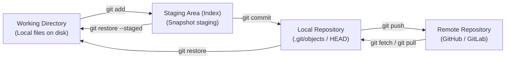
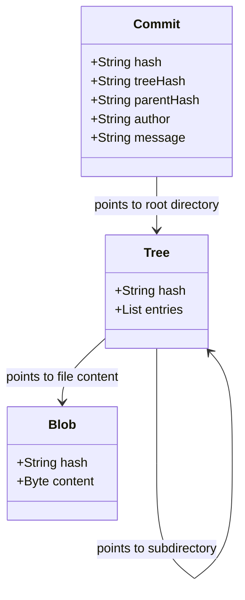

# 03. Git Architecture and Fundamentals

Understanding Git's internal architecture transforms Git from a collection of memorized terminal commands into an intuitive, predictable mental model.

---

## The Four Areas of Git

Git manages your code across four distinct zones:

### 1. Working Directory
The sandbox on your filesystem where you edit, create, and delete files using your text editor or IDE. Files here are either:
- **Untracked:** Files that Git has never tracked.
- **Tracked & Modified:** Tracked files with edits not yet staged.
- **Tracked & Unmodified:** Tracked files matching the last commit.

### 2. Staging Area (Index)
A binary cache file (`.git/index`) that prepares and structures the exact content of your next commit. Rather than committing all working edits, the staging area allows you to craft precise, atomic snapshots.

### 3. Local Repository
The permanent database stored inside the `.git` directory. Once changes are committed here, they become permanent, immutable snapshots referenced by a commit hash.

### 4. Remote Repository
The version hosted on GitHub or another remote server, used for collaboration and off-site backup.

---

## Snapshots vs Differences

Older version control systems (such as CVS or Subversion) store changes as incremental line-by-line file differences (deltas).

Git does not store deltas. **Git stores snapshots.**

Every time you commit, Git creates a snapshot of all tracked files at that exact moment. To keep the repository lightweight, if a file has not changed between commits, Git does not duplicate the file—it simply stores a link to the previously stored identical object.

---

## The Git Object Model

Inside the `.git/objects/` folder, Git stores four fundamental object types, each identified by a unique 40-character SHA-1 (or SHA-256) hash:

1. **Blob (Binary Large Object):** Stores pure file content. File names, permissions, and directory structures are not stored in the blob itself.
2. **Tree:** Represents a directory. A tree references blobs (files) and other sub-trees (subdirectories), along with their file names and permissions.
3. **Commit:** Contains metadata: author, committer, timestamp, commit message, a pointer to the root project tree, and pointers to zero, one, or more parent commits.
4. **Annotated Tag:** A permanent pointer to a specific commit containing tagger name, date, and release message.

---

## Inside the `.git` Directory

When you run `git init`, Git creates a hidden directory named `.git`. Key components include:

- `HEAD`: A plain text file pointing to the currently checked-out branch (e.g., `ref: refs/heads/main`).
- `config`: Repository-specific configuration settings.
- `index`: The binary staging area file.
- `objects/`: The object database containing all compressed blobs, trees, commits, and tags.
- `refs/`: Pointers to commit objects:
  - `refs/heads/`: Local branch pointers.
  - `refs/remotes/`: Remote-tracking branch pointers.
  - `refs/tags/`: Tag pointers.

---

## Next Step

With Git's internal model clear, proceed to the daily essential commands for creating, tracking, staging, and committing files:

-> **Next Guide:** [04. Essential Git Commands](04.%20Essential%20Git%20Commands.md)
