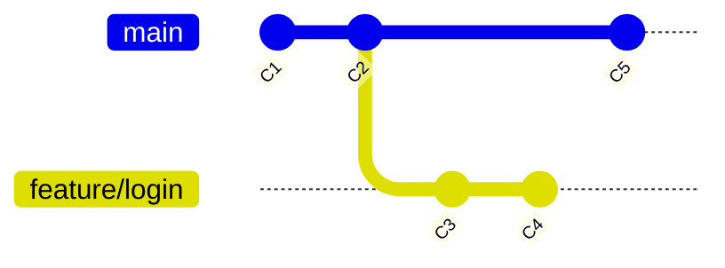
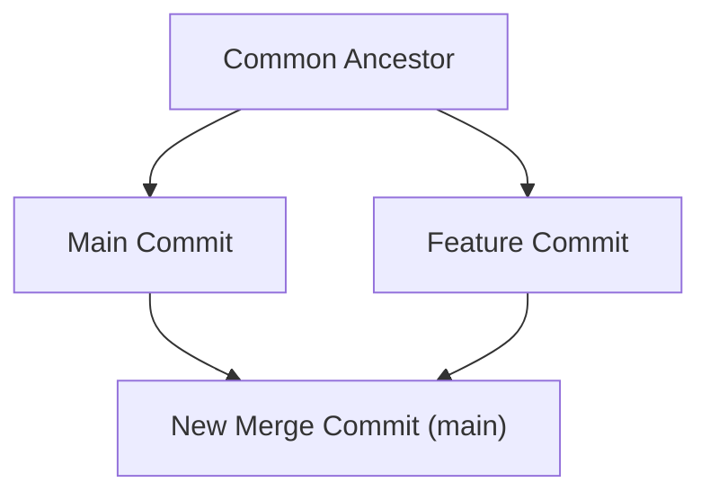

# 06. Branching and Merging

In Git, branches are lightweight, movable pointers to commits. They allow multiple developers (or a single developer working on multiple tasks) to work in complete isolation without disrupting the main codebase.

---

## How Branches Work in Git

Unlike version control systems that copy entire directory trees, a Git branch is simply a 41-byte text file containing a 40-character commit SHA. Creating a branch is instantaneous and costs zero storage overhead.



In the diagram above, `main` and `feature/login` share common ancestor commit `C2`, but have diverged with independent commits.

---

## 1. Inspecting Branches

### View local branches:
```bash
git branch
```
The active branch is marked with an asterisk `*` and highlighted.

### View all branches (local and remote-tracking):
```bash
git branch -a
```

### Inspect tracking status and ahead/behind metrics (`-vv`):
```bash
git branch -vv
```

Example output:
```text
* main           5a0e23d [origin/main: ahead 1] feat: add login
  feature/navbar 1b8f42a [origin/feature/navbar] docs: update header
```

---

## 2. Modern Branch Navigation (`git switch`)

> [!NOTE]
> Git 2.23 introduced `git switch` specifically for navigating and creating branches, separating branch operations from file restoration (`git restore`).

### Create and switch to a branch:
```bash
git switch -c feature/shopping-cart
```
*(Classic equivalent: `git checkout -b feature/shopping-cart`)*

### Switch to an existing local branch:
```bash
git switch feature/shopping-cart
```

### Switch back to the previously active branch:
```bash
git switch -
```

---

## 3. Merging Branches: Fast-Forward vs 3-Way Merge

When integrating changes from a feature branch into `main`, Git performs either a **Fast-Forward** merge or a **3-Way (ORT)** merge.

### Fast-Forward Merge
Occurs when no new commits have been made on the target branch (`main`) since the feature branch was branched. Git simply moves the `main` pointer forward to match the feature branch tip.

```mermaid
flowchart LR
    subgraph Before["Before Fast-Forward"]
        A1[Commit A] --> B1[Commit B (main)]
        B1 --> C1[Commit C (feature)]
    end
    subgraph After["After git merge feature"]
        A2[Commit A] --> B2[Commit B]
        B2 --> C2["Commit C (main, feature)"]
    end
```

Command:
```bash
git switch main
git merge feature/shopping-cart
```

### 3-Way (Recursive / ORT) Merge
Occurs when both branches have added independent commits since diverging. Git identifies the common ancestor commit, compares both branch heads, and creates a new **merge commit** with two parent commits.



To enforce creating a merge commit even if a fast-forward is possible:
```bash
git merge --no-ff feature/shopping-cart -m "merge: integrate feature/shopping-cart"
```

---

## 4. Resolving Merge Conflicts

A merge conflict occurs when Git cannot automatically reconcile changes—typically when the same line of a file is modified differently on both branches.

### Conflict Output:
```text
Auto-merging src/app.js
CONFLICT (content): Merge conflict in src/app.js
Automatic merge failed; fix conflicts and then commit the result.
```

### Conflict Markers:
Opening the conflicting file reveals Git's conflict markers:

```javascript
<<<<<<< HEAD
const API_URL = "https://api.production.com";
=======
const API_URL = "https://api.staging.com";
>>>>>>> feature/api-update
```

- `<<<<<<< HEAD`: Code in your currently checked-out branch.
- `=======`: Boundary divider.
- `>>>>>>> feature/api-update`: Code coming from the incoming branch.

### Resolution Steps:
1. Open the file and determine the correct final code.
2. Delete the conflict marker lines (`<<<<<<<`, `=======`, `>>>>>>>`).
3. Save the file.
4. Stage the resolved file:
   ```bash
   git add src/app.js
   ```
5. Complete the merge commit:
   ```bash
   git commit -m "fix(merge): resolve API_URL conflict between main and feature"
   ```

### Aborting a Conflicted Merge:
To cancel the merge operation and safely restore your working tree to its pre-merge state:
```bash
git merge --abort
```

---

## 5. Deleting Branches

Once a feature is merged and pushed to GitHub, delete the branch to maintain a clean repository.

### Safe Delete (Verifies branch is fully merged):
```bash
git branch -d feature/shopping-cart
```

### Force Delete (Deletes unmerged work):
```bash
git branch -D feature/shopping-cart
```

### Delete Remote Branch on GitHub:
```bash
git push origin --delete feature/shopping-cart
```

---

## Branching Commands Reference

| Task | Modern Command | Classic Command |
|---|---|---|
| Create and switch | `git switch -c <name>` | `git checkout -b <name>` |
| Switch branch | `git switch <name>` | `git checkout <name>` |
| Return to previous branch | `git switch -` | `git checkout -` |
| View detailed tracking | `git branch -vv` | - |
| Merge branch | `git merge <name>` | - |
| Abort conflicted merge | `git merge --abort` | - |
| Safe branch deletion | `git branch -d <name>` | - |
| Force branch deletion | `git branch -D <name>` | - |
| Delete remote branch | `git push origin --delete <name>` | - |

---

## Next Step

Learn how local branches connect and synchronize with remote repositories hosted on GitHub:

-> **Next Guide:** [07. Working with Remote Repositories](07.%20Working%20with%20Remote%20Repositories.md)
