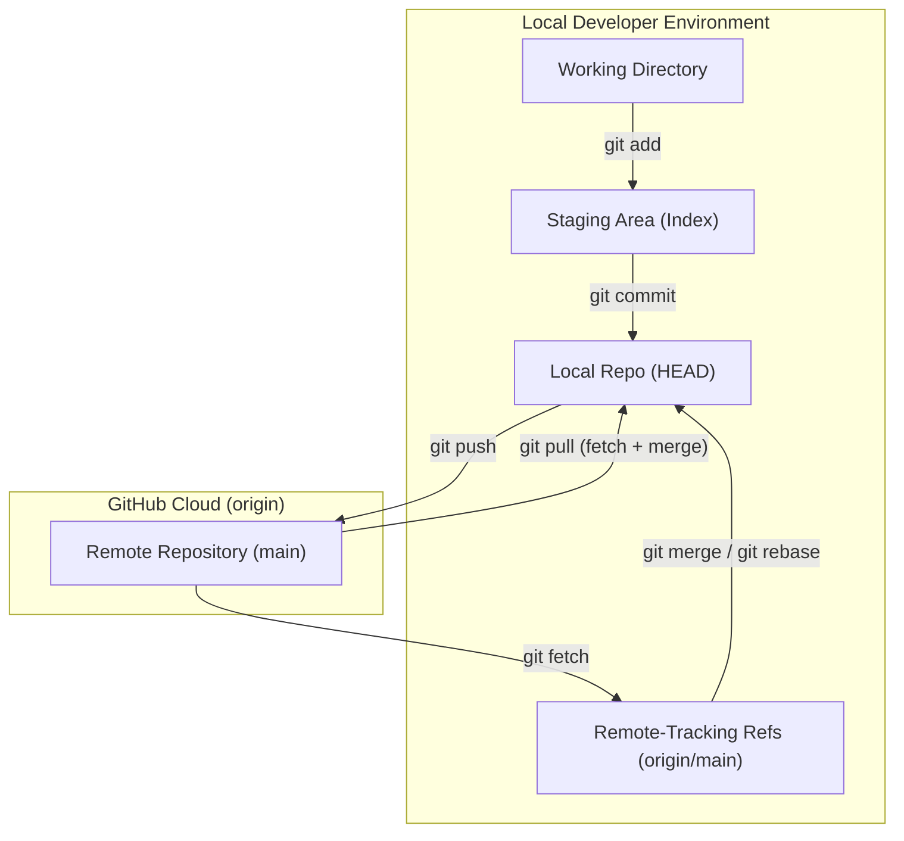

# 07. Working with Remote Repositories

A remote repository is a version of your project hosted on a shared network or cloud platform, most commonly GitHub. Remotes enable team collaboration, off-site backup, and automated continuous deployment.

---

## Remote Architecture



---

## 1. Inspecting Remote Connections

To view the names and URLs of all configured remotes:

```bash
git remote -v
```

Example output:
```text
origin  https://github.com/username/project.git (fetch)
origin  https://github.com/username/project.git (push)
```

Inspect detailed remote metadata (tracking branches, pull/push configurations):
```bash
git remote show origin
```

---

## 2. Managing Remotes

### Connect a local repository to GitHub:
```bash
git remote add origin https://github.com/username/project.git
```

### Change a remote URL (e.g., HTTPS to SSH):
```bash
git remote set-url origin git@github.com:username/project.git
```

### Rename a remote:
```bash
git remote rename origin upstream
```

### Remove a remote:
```bash
git remote remove origin
```

---

## 3. Fetch vs Pull

Understanding the distinction between fetching and pulling is critical for team collaboration:

### `git fetch`
Downloads commits, files, and refs from the remote repository into your local **remote-tracking branches** (e.g., `origin/main`), but does **not** modify your working files or your checked-out branch.

`git fetch` is safe to run at any time:
```bash
git fetch origin

# Inspect incoming changes before integrating:
git log HEAD..origin/main --oneline
```

### `git pull`
Combines `git fetch` with an immediate `git merge` of the corresponding remote-tracking branch into your current local branch.

### Linear History with `git pull --rebase`
By default, `git pull` creates a merge commit whenever both local and remote branches have new commits. To maintain a clean linear history without merge bubbles:

```bash
git pull --rebase origin main
```

To configure rebase as the default behavior for all pulls:
```bash
git config --global pull.rebase true
```

---

## 4. Upstream Tracking Branches

When creating a new local branch, GitHub does not track it until upstream configuration is established.

### Push and configure upstream tracking (`-u`):
```bash
git push -u origin feature/user-profile
```

Once linked, subsequent operations only require:
```bash
git push
git pull
```

### Link an existing local branch to remote:
```bash
git branch --set-upstream-to=origin/feature/user-profile
```

---

## 5. Pruning Stale Tracking References

When teammates delete merged branches on GitHub, your local repository retains stale references to those deleted branches.

To fetch updates and purge deleted remote-tracking references:

```bash
git fetch --prune
```

To enable pruning automatically on every fetch:
```bash
git config --global fetch.prune true
```

---

## 6. Safe History Rewriting: `--force-with-lease`

If you rebased or amended a commit that was previously pushed to a feature branch, Git rejects standard `git push`.

### Do Not Use Plain `--force`:
`git push --force` blindly overwrites the remote branch, destroying any commits your teammates may have pushed in the interim.

### Safe Alternative:
```bash
git push --force-with-lease
```
`--force-with-lease` verifies that the remote reference matches your local tracking reference. If someone else pushed commits to the remote branch, Git halts and refuses to overwrite their work.

---

## Remote Commands Reference

| Command | Purpose |
|---|---|
| `git remote -v` | List all configured remotes with URLs |
| `git remote add <name> <url>` | Add a new remote connection |
| `git remote set-url <name> <url>` | Update the URL of an existing remote |
| `git fetch origin` | Download commits without modifying local working tree |
| `git fetch --prune` | Fetch and delete stale remote tracking references |
| `git pull --rebase` | Fetch and reapply local commits on top of remote branch |
| `git push -u origin <branch>` | Push and establish upstream tracking |
| `git push --force-with-lease` | Safely push rewritten history without destroying team commits |
| `git push origin --delete <branch>` | Delete a branch on the remote server |

---

## Next Step

Explore GitHub's cloud platform features including repositories, forks, discussions, and open-source contribution patterns:

-> **Next Guide:** [08. Exploring GitHub Features](08.%20Exploring%20GitHub%20Features.md)
