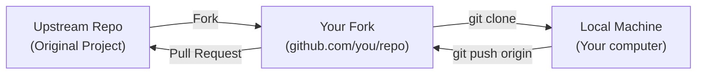

# 08. Exploring GitHub Features

GitHub extends Git with an integrated platform for hosting repositories, managing code reviews, coordinating teams, and publishing open-source projects.

---

## 1. Repository Management

### Anatomy of a GitHub Repository
When viewing a repository on GitHub, several key components are accessible:
- **Code Tab:** View directory structures, browse commit histories, tags, branches, and README files.
- **Commits:** Chronological list of snapshots with commit hashes, messages, author avatars, and diffs.
- **Releases:** Downloadable release assets, source code archives, and version changelogs.
- **Insights:** Visual analytics showing commit frequency, contributor statistics, traffic, dependency trees, and network graphs.

### Creating a Repository
1. Click the `+` icon in the top navigation bar -> **New repository**.
2. Specify Repository name, Description, and Visibility (Public or Private).
3. Optional initializations:
   - Add a `README.md`
   - Add `.gitignore` template (language-specific)
   - Choose a license (e.g., MIT, Apache 2.0)

---

## 2. Forks: The Open-Source Contribution Model

A **Fork** is an independent server-side copy of someone else's GitHub repository created under your own GitHub account.

### How Open-Source Contributions Work:
1. **Fork:** Create your copy of the upstream repository on GitHub.
2. **Clone:** Clone your fork to your local machine:
   ```bash
   git clone https://github.com/<your-username>/<repo-name>.git
   ```
3. **Configure Upstream:** Connect the original repository as `upstream` to stay synchronized:
   ```bash
   git remote add upstream https://github.com/<original-owner>/<repo-name>.git
   ```
4. **Develop:** Create a feature branch, commit changes, and push to your fork (`origin`).
5. **Pull Request:** Open a Pull Request from your fork's branch into the original repository's `main` branch.



---

## 3. Discussions and Team Forums

**GitHub Discussions** is a collaborative communication forum within a repository. Unlike Issues (which represent actionable tasks or bug fixes), Discussions are suited for:
- Q&A and technical support.
- Brainstorming RFCs (Request for Comments) and architecture proposals.
- General community announcements.

Enable Discussions via **Settings** -> **Features** -> Check **Discussions**.

---

## 4. Repository Access and Collaborator Roles

Repositories support granular permission levels:

| Role | Permissions | Best For |
|---|---|---|
| **Read** | View, clone, open issues, fork | Open-source contributors, reviewers |
| **Triage** | Manage issues, pull requests, labels, milestones | Bug triage team |
| **Write** | Push directly to unprotected branches, merge PRs | Core development team |
| **Maintain** | Manage repository settings and rulesets | Team leads |
| **Admin** | Full access including deletion and billing | Repository owners |

---

## Next Step

Learn how to manage software tasks with GitHub Issues, submit code reviews, and automate issue closing with Pull Requests:

-> **Next Guide:** [09. Working with GitHub Issues & Pull Requests](09.%20Working%20with%20GitHub%20Issues%20&%20Pull%20Requests.md)
