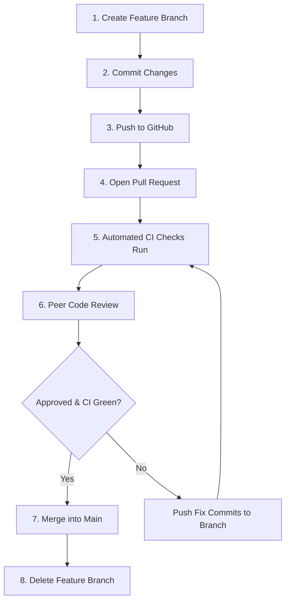

# 09. Working with GitHub Issues & Pull Requests

Issues and Pull Requests (PRs) form the core collaboration workflow on GitHub, enabling teams to plan work, review code, enforce automated checks, and merge contributions safely.

---

## 1. Tracking Work with GitHub Issues

An **Issue** is an actionable ticket used to track bugs, enhancements, technical debt, and architectural tasks.

### Anatomy of a High-Quality Issue:
- **Descriptive Title:** `fix(auth): session expires prematurely on Safari` rather than `login broken`.
- **Environment Details:** OS, browser, Git version, runtime environment.
- **Steps to Reproduce:** Exact sequence of steps to trigger the bug.
- **Expected vs Actual Behavior:** Clear description of what should happen versus what actually happened.

### Metadata:
- **Assignees:** Developers responsible for resolving the issue.
- **Labels:** Categorization tags (e.g., `bug`, `enhancement`, `good first issue`, `documentation`).
- **Milestones:** Target release deadlines (e.g., `v1.2.0-rc1`).

---

## 2. The Pull Request (PR) Workflow

A **Pull Request** proposes merging code changes from a feature branch into a target branch (such as `main`). It provides a dedicated interface for discussing changes, viewing line-by-line diffs, and running automated tests.



---

## 3. Creating and Reviewing Pull Requests

### Opening a PR:
1. Navigate to your repository on GitHub.
2. Click **Pull requests** -> **New pull request**.
3. Select the **base** branch (`main`) and the **compare** branch (`feature/login`).
4. Fill out the title and description using the repository's PR template.
5. If the work is still in progress, select **Create draft pull request**. Draft PRs cannot be merged until marked "Ready for review".

### Linking Issues to Automatically Close on Merge:
Include specific closing keywords followed by the issue number in your PR description:
```text
Closes #42
Fixes #87
Resolves #104
```
When the PR is merged into the default branch, GitHub automatically marks the referenced issues as closed!

---

## 4. Code Review Best Practices

### For Reviewers:
- **Line Comments:** Click on specific diff lines in the **Files changed** tab to start an in-line review thread.
- **Suggestions:** Use GitHub's suggestion syntax to propose code diffs that the author can commit with one click:
  ````markdown
  ```suggestion
  const token = req.headers.authorization?.split(' ')[1];
  ```
  ````
- **Review Verdicts:**
  - **Comment:** General feedback without approval or blockage.
  - **Approve:** Work is satisfactory and ready to merge.
  - **Request changes:** Issues must be addressed before merging.

### For Authors:
- Respond respectfully to feedback.
- Push corrective commits directly to your feature branch; the PR automatically updates with the new commits.
- Resolve conversations once resolved.

---

## 5. Merging Strategies

GitHub provides three merge methods:

| Method | Mechanics | When to Use |
|---|---|---|
| **Create a merge commit** | Preserves all commits on the branch and adds a 3-way merge commit. | When preserving granular feature history is critical. |
| **Squash and merge** | Combines all branch commits into a single unified commit on `main`. | **Recommended for most teams.** Keeps `main` commit history clean and linear. |
| **Rebase and merge** | Reapplies commits individually onto the tip of `main` without a merge commit. | When maintaining a 100% linear history without squash consolidation. |

---

## Next Step

Learn how to manage Pull Requests, Issues, Releases, and CI workflows directly from your terminal using the official GitHub CLI:

-> **Next Guide:** [10. GitHub CLI (Command-Line Power)](10.%20GitHub%20CLI%20(Command-Line%20Power).md)
