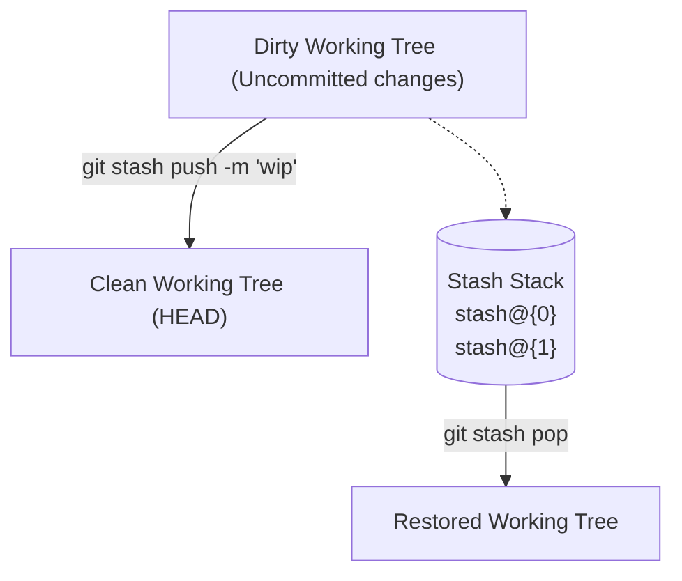
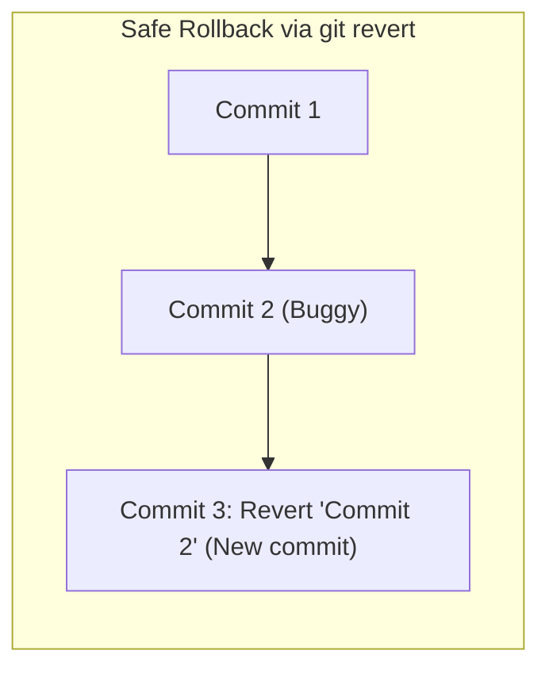

# 11. Git Stash & Revert

In software development, interruptions frequently occur: an urgent production bug requires your attention while you are halfway through an uncommitted feature, or a bad commit reaches a shared branch.

**Git Stash** and **Git Revert** are your primary tools for handling these situations safely.

---

## 1. Git Stash: Shelving Work Temporarily

`git stash` records your uncommitted modifications (staged and unstaged) onto an internal stash stack and reverts your working tree to match the clean `HEAD` commit.



---

### Basic and Descriptive Stash

By default, `git stash` generates a generic message. Using descriptive messages is recommended:

```bash
git stash push -m "wip: shopping cart checkout calculations"
```

### Stashing Untracked Files (`-u` / `--include-untracked`)

> [!IMPORTANT]
> By default, `git stash` ignores newly created files that have not yet been added (`git add`). If you created new files, use `-u` so they are included in the stash:

```bash
git stash -u -m "wip: add auth middleware and new test files"
```

### Interactive Patch Stashing (`-p`)
Stash only selected change hunks while keeping the rest in your working tree:
```bash
git stash -p
```

### Inspecting and Restoring Stashes

- **List stashes:**
  ```bash
  git stash list
  ```
- **Inspect stash diff:**
  ```bash
  git stash show -p stash@{0}
  ```
- **Pop latest stash (restores and deletes from stack):**
  ```bash
  git stash pop
  ```
- **Apply stash (restores but keeps on stack):**
  ```bash
  git stash apply stash@{0}
  ```
- **Drop a specific stash:**
  ```bash
  git stash drop stash@{0}
  ```
- **Create a branch from a stash:**
  If your branch has moved forward and applying the stash causes conflicts, create a new branch from the exact commit where the stash was taken:
  ```bash
  git stash branch recovery-branch stash@{0}
  ```

> [!CAUTION]
> `git stash clear` permanently deletes all stashes across your repository.

---

## 2. Git Revert: Safe History Rollbacks

When a bug reaches a shared remote branch (`main`), how should you undo it?

- **`git reset`** moves the branch pointer backward. It rewrites history and requires a dangerous force push on shared branches.
- **`git revert`** creates a **new commit** that introduces the exact inverse of the target commit. It preserves history and is safe for shared branches.



---

### Reverting Commits

### Revert the latest commit:
```bash
git revert HEAD
```

### Revert an older commit by hash:
```bash
git revert 5a0e23d
```

### Revert without committing immediately (`--no-commit`):
Useful when you need to revert multiple commits and group them into a single rollback commit:
```bash
git revert --no-commit commitA
git revert --no-commit commitB
git commit -m "fix: revert payment migration changes"
```

---

## Reset vs Revert: When to Use Which?

| Feature | `git reset` | `git revert` |
|---|---|---|
| **Mechanism** | Moves branch pointer backward | Creates a new commit inverting changes |
| **Rewrites History?** | Yes | No |
| **Safe for Shared Branches?** | Never (disrupts collaborator repos) | Yes (standard team practice) |
| **Primary Use Case** | Local, unpushed commits | Public commits already on GitHub |

---

## Command Reference

| Command | Action |
|---|---|
| `git stash push -u -m "<msg>"` | Stash tracked and untracked files with custom message |
| `git stash list` | View all stashed entries |
| `git stash pop` | Apply and remove latest stash |
| `git stash apply <stash_id>` | Apply stash without removing from stack |
| `git stash drop <stash_id>` | Delete a specific stash |
| `git stash branch <name>` | Create a new branch starting from stash commit |
| `git revert <commit_hash>` | Create a new commit that inverts target commit |
| `git revert --no-commit <hash>` | Invert changes in working tree without auto-committing |

---

## Next Step

Learn how to maintain linear history with rebase, squash messy commits interactively, and cherry-pick specific commits across branches:

-> **Next Guide:** [12. Git Rebase & Cherry-pick](12.%20Git%20Rebase%20&%20Cherry-pick.md)
