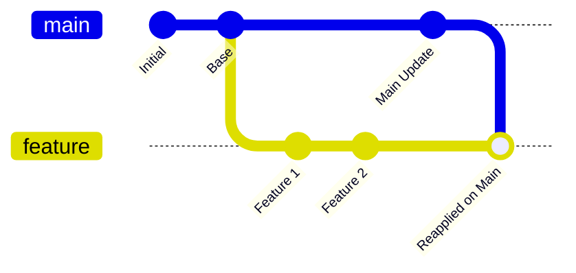
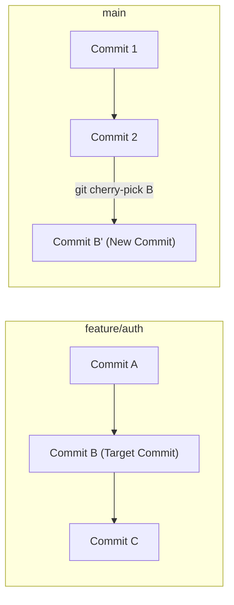

# 12. Git Rebase & Cherry-pick

This chapter examines git rebase and git cherry-pick, two commands used to structure commit history and transfer individual revisions between branches.

---

## 1. Git Rebase

When integrating updates from a base branch (such as `main`) into a topic branch, `git merge` adds a merge commit. `git rebase` instead takes the unique commits on your topic branch and reapplies them sequentially onto the updated tip of the base branch.



### Basic Rebase Workflow

```bash
# 1. Update your local main branch
git switch main
git pull origin main

# 2. Switch to your feature branch and rebase
git switch feature/payment
git rebase main
```

If conflicts arise:
1. Edit the affected files to resolve the conflicts.
2. Stage the resolved files: `git add <file>`
3. Continue the rebase: `git rebase --continue`
4. Or cancel and return to the prior state: `git rebase --abort`

---

## 2. Interactive Rebase (`git rebase -i`)

Interactive rebasing lets you modify, reorder, combine, or remove commits before opening a pull request.

```bash
git rebase -i HEAD~3
```

In the text editor, select actions for each commit:
- `pick`: Include the commit as-is.
- `reword`: Keep commit contents, but edit the message.
- `edit`: Pause during rebase to modify files or commit contents.
- `squash`: Combine this commit into the preceding one and merge messages.
- `fixup`: Combine this commit into the preceding one, discarding this message.
- `drop`: Remove the commit entirely.

### Verification with `git range-diff`
To verify that code semantics did not unintentionally change after an interactive rebase:

```bash
git range-diff origin/feature/payment..HEAD
```

---

## 3. The Rebase Safety Rule

> [!WARNING]
> Do not rebase commits that have already been published to shared remote branches such as `main` or `develop`. Reapplying commits alters their commit hashes. If teammates have built upon those commits, rewriting their history causes synchronization conflicts.

---

## 4. Git Cherry-pick

`git cherry-pick` applies the changes from an existing commit onto your current working branch without merging the branch where that commit originated.



### Apply a Single Commit:
```bash
git switch main
git cherry-pick 5a0e23d
```

### Include Provenance Information (`-x`):
The `-x` flag appends an automated note recording the source commit hash:
```bash
git cherry-pick -x 5a0e23d
```

### Apply a Range of Commits:
```bash
git cherry-pick commitA..commitD
```

If conflicts occur during a cherry-pick:
```bash
git cherry-pick --continue
# or cancel:
git cherry-pick --abort
```

---

## Command Summary

| Command | Action |
|---|---|
| `git rebase <target>` | Reapply topic branch commits onto `<target>` |
| `git rebase -i HEAD~N` | Interactively modify the preceding `N` commits |
| `git rebase --continue` | Resume rebase after resolving conflict |
| `git rebase --abort` | Cancel rebase and restore prior state |
| `git range-diff <old>..<new>` | Inspect diff of commit series before and after rebase |
| `git cherry-pick <hash>` | Apply a specific commit onto current branch |
| `git cherry-pick -x <hash>` | Apply commit with origin reference metadata |
| `git cherry-pick --abort` | Cancel cherry-pick operation in progress |

---

## Next Step

Learn how to recover from mistakes, restore deleted branches, and inspect reference logs:

-> **Next Guide:** [13. Git Rescue Handbook](13.%20Git%20Rescue%20Handbook.md)
