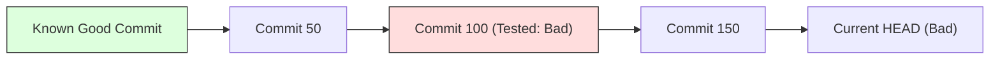
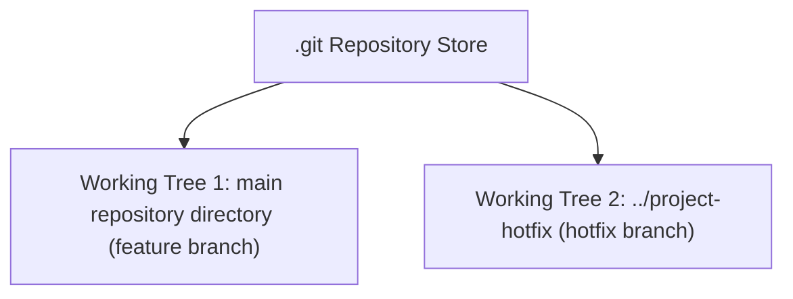

# 14. Advanced Git: Bisect, Worktrees, Submodules & LFS

This guide covers advanced Git features designed for complex codebases, multi-branch workflows, and repositories containing large binary assets.

---

## 1. Automated Regression Debugging (`git bisect`)

`git bisect` uses binary search through repository history to identify which specific commit introduced a bug or test regression.



### Manual Bisect Procedure

1. Start the bisect session:
   ```bash
   git bisect start
   ```
2. Mark the current broken commit as bad:
   ```bash
   git bisect bad
   ```
3. Mark a known historical commit or tag as good:
   ```bash
   git bisect good v1.0.0
   ```
4. Git checks out midpoint revisions. Test each revision and report status:
   - If tests pass: `git bisect good`
   - If tests fail: `git bisect bad`
5. Once Git identifies the first bad commit, end the session:
   ```bash
   git bisect reset
   ```

### Automated Bisect (`git bisect run`)
When an automated test script exists:
```bash
git bisect start HEAD v1.0.0
git bisect run npm test
```
Git runs the script at each binary search step, isolates the faulty commit automatically, and prints the result.

---

## 2. Simultaneous Multi-Branch Workspaces (`git worktree`)

`git worktree` enables maintaining multiple working directories linked to a single Git repository. This lets you work on multiple branches at the same time without needing to stash uncommitted files or switch back and forth.



### Usage:

```bash
# Add a secondary worktree checked out to a new branch:
git worktree add ../project-hotfix -b hotfix/patch main

# List registered worktrees:
git worktree list

# Remove a worktree after completing work:
git worktree remove ../project-hotfix
```

---

## 3. Managing External Dependencies (`git submodule`)

Submodules allow embedding another Git repository inside a parent repository, tracking a specific commit hash.

```bash
# Add an external repository as a submodule:
git submodule add https://github.com/example/ui-components.git vendor/ui

# Clone a repository including all nested submodules:
git clone --recurse-submodules https://github.com/example/main-repo.git

# Initialize submodules in an already-cloned repository:
git submodule update --init --recursive

# Update submodules to the latest upstream revisions:
git submodule update --remote --merge
```

---

## 4. Git Large File Storage (Git LFS)

Standard Git is optimized for text diffs. Storing large binary files (such as database snapshots, machine learning weights, audio, or video files) causes repository sizes to grow rapidly.

Git LFS stores large files on a remote storage server while placing tiny pointer files (~130 bytes) in your local Git repository.

### Configuration Steps:

```bash
# 1. Install Git LFS hooks locally
git lfs install

# 2. Configure file patterns to track
git lfs track "*.psd"
git lfs track "*.onnx"
git lfs track "datasets/**"

# 3. Commit the generated .gitattributes file
git add .gitattributes
git commit -m "chore: configure Git LFS tracking"

# 4. Inspect currently tracked LFS files
git lfs ls-files
```

---

## 5. Monorepo Navigation (`git sparse-checkout`)

In very large repositories, you can configure Git to populate only the subdirectories you need in your working tree:

```bash
# Initialize sparse-checkout in cone mode
git sparse-checkout init --cone

# Specify directories to include
git sparse-checkout set services/auth-service shared/types

# Revert to full repository checkout
git sparse-checkout disable
```

---

## Summary Reference

| Tool | Primary Command | Purpose |
|---|---|---|
| **Bisect** | `git bisect start` | Binary search regression identification |
| **Bisect** | `git bisect run <cmd>` | Automated test-driven bug isolation |
| **Worktree** | `git worktree add <dir> <branch>` | Create simultaneous parallel working directory |
| **Worktree** | `git worktree remove <dir>` | Unregister and clean up secondary directory |
| **Submodule**| `git submodule add <url>` | Embed external repository |
| **Submodule**| `git submodule update --init --recursive` | Populate submodules after cloning |
| **LFS** | `git lfs track "*.ext"` | Track large binaries via pointers |
| **Sparse** | `git sparse-checkout set <dir>` | Limit working tree to specific directories |

---

## Next Step

Learn how to automate continuous integration, testing pipelines, and build verification using GitHub Actions:

-> **Next Guide:** [15. GitHub Actions & CI-CD](15.%20GitHub%20Actions%20&%20CI-CD.md)
