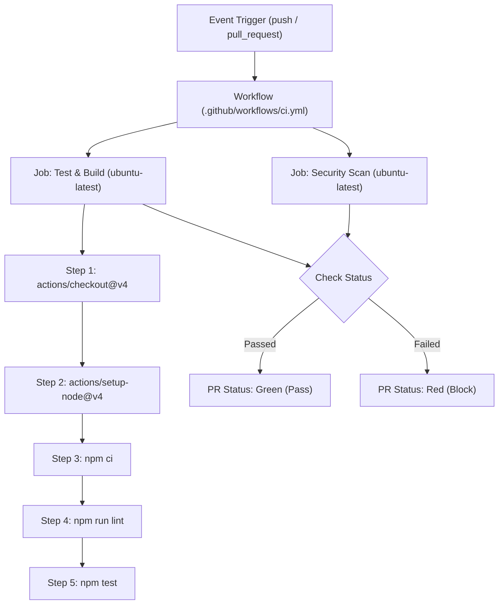

# 15. GitHub Actions & CI-CD

GitHub Actions provides built-in automation for building, testing, packaging, and deploying software projects directly within GitHub.

---

## 1. Core Architecture



### Concepts
- **Workflow:** An automated YAML configuration file placed in `.github/workflows/`.
- **Event:** A condition that starts a workflow (`push`, `pull_request`, `schedule`, `workflow_dispatch`).
- **Job:** A set of execution steps that run on an assigned virtual runner. Jobs run in parallel by default.
- **Step:** An individual task within a job (either a shell command or an action).
- **Runner:** The host environment executing the job (`ubuntu-latest`, `windows-latest`, `macos-latest`).

---

## 2. Production CI Workflow Template

Create `.github/workflows/ci.yml`:

```yaml
name: Continuous Integration

on:
  push:
    branches: [main, develop]
  pull_request:
    branches: [main]
  workflow_dispatch:

permissions:
  contents: read

concurrency:
  group: ${{ github.workflow }}-${{ github.ref }}
  cancel-in-progress: true

jobs:
  test-and-build:
    name: Build, Lint & Test
    runs-on: ubuntu-latest
    timeout-minutes: 15

    steps:
      - name: Checkout Code
        uses: actions/checkout@v4

      - name: Setup Node.js 20
        uses: actions/setup-node@v4
        with:
          node-version: 20
          cache: "npm"

      - name: Install Dependencies
        run: npm ci

      - name: Run Linter
        run: npm run lint --if-present

      - name: Run Test Suite
        run: npm test --if-present

      - name: Verify Build Output
        run: npm run build --if-present
```

---

## 3. Implementation Details

1. **`npm ci` vs `npm install`:**  
   In CI runners, `npm ci` verifies that `package-lock.json` matches `package.json` exactly. It produces clean, deterministic builds without mutating lockfiles.
2. **Minimal Permissions:**  
   Setting `permissions: contents: read` restricts access tokens to read-only mode, reducing attack surfaces.
3. **Dependency Caching:**  
   Specifying `cache: "npm"` in `actions/setup-node` caches dependencies between runs, reducing pipeline execution duration.
4. **Concurrency Controls:**  
   Setting `cancel-in-progress: true` automatically stops redundant runs when new commits are pushed to the same branch.

---

## 4. Matrix Builds

To validate builds across multiple runtime versions and operating systems simultaneously:

```yaml
jobs:
  matrix-build:
    runs-on: ${{ matrix.os }}
    strategy:
      matrix:
        os: [ubuntu-latest, windows-latest]
        node-version: [18, 20, 22]

    steps:
      - uses: actions/checkout@v4
      - uses: actions/setup-node@v4
        with:
          node-version: ${{ matrix.node-version }}
          cache: "npm"
      - run: npm ci
      - run: npm test
```

---

## 5. Troubleshooting Workflows via GitHub CLI

To inspect and diagnose failed CI runs from the terminal:

```bash
# List recent runs
gh run list

# Inspect failure logs
gh run view <run-id> --log-failed

# Re-run failed jobs
gh run rerun <run-id> --failed
```

---

## Next Step

Learn how to configure repository governance, branch rulesets, automated review routing, and security scanning:

-> **Next Guide:** [16. GitHub Security & Repository Management](16.%20GitHub%20Security%20&%20Repository%20Management.md)
