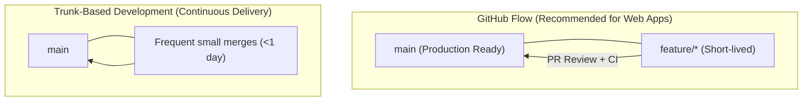

# 18. Best Practices & Professional Workflow

Adopting standardized branching conventions, structured commit formats, and code review standards ensures long-term repository maintainability and reduces integration defects.

---

## 1. Commit Message Conventions: Conventional Commits

Using structured commit formats allows automated tools to generate changelogs and determine semantic version increments.

### Format Structure:
```text
<type>[optional scope]: <description>

[optional body explaining why the change was necessary]

[optional footer(s), e.g., Closes #42]
```

### Recognized Types:
| Type | Usage | Example |
|---|---|---|
| `feat` | New functionality | `feat(api): add rate limiting middleware` |
| `fix` | Bug correction | `fix(checkout): resolve price calculation discrepancy` |
| `docs` | Documentation updates | `docs(readme): add setup instructions for Linux` |
| `refactor`| Code restructure without behavior change | `refactor(db): extract user query to repository module` |
| `test` | Adding or updating tests | `test(auth): add unit tests for JWT validator` |
| `chore` | Build tasks, package updates, tooling | `chore(deps): update vite to v5.3` |

---

## 2. Comparing Branching Strategies



### GitHub Flow:
- `main` remains continuously deployable.
- Developers branch from `main`, push commits, open pull requests, and merge back into `main` after CI checks pass.
- Suited for web applications and microservices.

### Git Flow:
- Utilizes long-lived branches: `main` (production) and `develop` (integration), alongside temporary `feature/`, `release/`, and `hotfix/` branches.
- Suited for scheduled release cycles, such as desktop or embedded software.

### Trunk-Based Development:
- Developers merge small, frequent updates directly into `main` or through short-lived branches (<24 hours).
- Relies heavily on automated test suites and feature flags.

---

## 3. Versioning and Release Tagging

Use Semantic Versioning (SemVer): `MAJOR.MINOR.PATCH` (e.g., `v1.2.0`).

### Annotated Tags:
Always create annotated tags for releases, as they store the tagger name, timestamp, and release description:

```bash
# Create annotated tag
git tag -a v1.2.0 -m "Release v1.2.0: Core architecture and documentation overhaul"

# View tag details
git show v1.2.0

# Push tag to remote
git push origin v1.2.0
```

---

## Next Step

Learn how to diagnose and resolve errors related to credentials, SSH connections, detached heads, and line endings:

-> **Next Guide:** [19. Troubleshooting Git & GitHub Issues](19.%20Troubleshooting%20Git%20&%20GitHub%20Issues.md)
