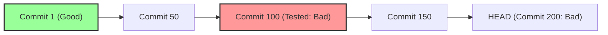
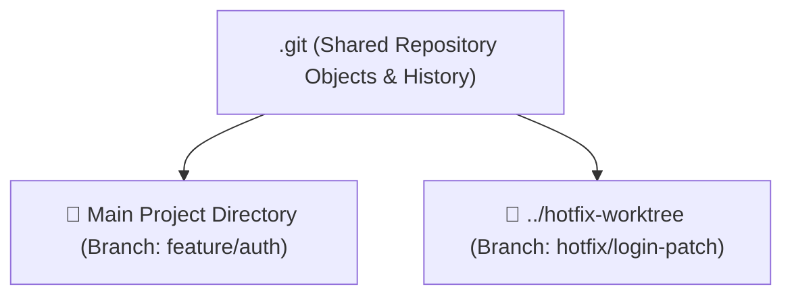
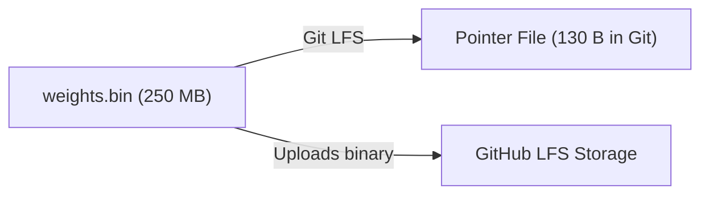

# 🔬 Advanced Git: Bisect, Worktrees, Submodules & LFS

## 🎯 Topic: Expert Tools for High-Scale, Multi-Branch & Large-Repository Workflows

When working on complex codebases, enterprise repositories, or projects with large binary assets, basic commit-and-push commands are not enough. 

This guide covers four indispensable advanced Git features:
1. 🐛 **`git bisect`** — Find regression bugs in seconds using automated binary search.
2. 🌳 **`git worktree`** — Work on multiple branches simultaneously in separate directories without stashing or switching.
3. 📦 **`git submodule`** — Embed external repositories within your project at specific commits.
4. 💾 **Git LFS** — Efficiently store and version large binary files (models, audio, video, zip datasets).
5. ⚡ **`git sparse-checkout`** — Download and work with only a specific subdirectory in huge monorepos.

---

## 🐛 1. `git bisect` — The Binary Search Bug Hunter

### The Scenario:
Your application was working perfectly in release `v1.0.0` (commit `A`), but somewhere in the last 200 commits, someone introduced a subtle regression bug. Manually checking 200 commits would take hours.

Instead, `git bisect` uses **binary search** to find the exact commit that introduced the bug in just $\approx \log_2(200) \approx 8$ tests!



---

### Step-by-Step Manual Bisect Session:

```bash
# 1. Start the bisect session
git bisect start

# 2. Tell Git that the current commit is broken
git bisect bad

# 3. Tell Git a known commit or tag where the code worked properly
git bisect good v1.0.0
```

Git immediately checks out the midpoint commit and tells you:
`Bisecting: 99 revisions left to test after this (roughly 7 steps)`

Now, test your code (run your tests or check the app).
- If it works: type `git bisect good`
- If it is broken: type `git bisect bad`

Git repeats this binary division until it prints:
```text
5a0e23df8b9a12c34d is the first bad commit
Author: John Doe <john@example.com>
Date:   Wed Oct 22 2025
    fix(auth): update session cookie expiration
```

Once finished, return your branch to normal:
```bash
git bisect reset
```

---

### ⚡ Automated Bisect with `git bisect run`
If you have an automated test script that returns exit code `0` for success and non-zero for failure:

```bash
git bisect start HEAD v1.0.0
git bisect run npm test
```
Git will run the test automatically across all binary search steps and output the exact guilty commit in seconds with zero manual intervention!

---

## 🌳 2. `git worktree` — Simultaneous Multi-Branch Workspaces

### The Problem:
You are in the middle of writing a 500-line feature on branch `feature/auth`. Suddenly, a critical production bug occurs on `main`. 
Normally, you would have to run `git stash`, switch branches, fix the bug, switch back, and run `git stash pop` — disrupting your running dev servers and build caches.

### The Solution:
`git worktree` allows you to have **multiple working directories linked to the same repository**, with each directory checking out a completely different branch!



---

### Worktree Commands:

#### 1. Create a linked worktree for an urgent fix:
```bash
# Syntax: git worktree add <directory-path> <branch-name>
git worktree add ../project-hotfix -b hotfix/urgent-patch main
```
This creates a new folder `../project-hotfix` checked out to a new branch `hotfix/urgent-patch`. Your original directory stays untouched!

#### 2. List active worktrees:
```bash
git worktree list
```
✅ **Output Example:**
```text
/home/user/project           5a0e23d [feature/auth]
/home/user/project-hotfix    9b1c2d3 [hotfix/urgent-patch]
```

#### 3. Complete work and clean up:
Work in `../project-hotfix`, commit, and push. Then remove the worktree:
```bash
git worktree remove ../project-hotfix
```

---

## 📦 3. `git submodule` — Embedding External Repositories

A **submodule** allows you to keep an external Git repository as a subdirectory of another Git repository.

### When to Use Submodules:
- Sharing a common design system or shared library between multiple repositories.
- Vendor code that must stay tracked to a specific upstream commit.

### Adding a Submodule:
```bash
git submodule add https://github.com/example/shared-ui.git vendor/shared-ui
```
This creates a `.gitmodules` file in your repository recording the submodule URL and path.

### Cloning a Repository That Contains Submodules:
When you clone a repository that uses submodules, the submodule folders are empty by default!

```bash
# Clone and populate submodules in one command:
git clone --recurse-submodules https://github.com/username/main-project.git

# If already cloned without the flag:
git submodule update --init --recursive
```

### Updating Submodules:
```bash
# Pull the latest commits for all registered submodules
git submodule update --remote --merge
```

---

## 💾 4. Git LFS (Large File Storage)

### The Problem:
Git is designed for text files. If you commit large binaries (e.g. 50MB `.psd` designs, `.onnx` machine learning models, `.mp4` videos, or zip datasets), Git saves the complete binary in its history every time a byte changes, causing the repository size to balloon exponentially.

### The Solution:
**Git LFS** replaces large files in your repository with tiny text pointer files ($\approx 130$ bytes). The actual binary contents are downloaded on demand from an LFS server.



---

### Step-by-Step Git LFS Setup:

#### 1. Install Git LFS locally:
```bash
git lfs install
```

#### 2. Track specific file patterns or extensions:
```bash
git lfs track "*.psd"
git lfs track "*.onnx"
git lfs track "datasets/**"
```
This automatically updates your `.gitattributes` file.

#### 3. Commit `.gitattributes` and your files:
```bash
git add .gitattributes
git add models/weights.onnx
git commit -m "feat: add machine learning model via LFS"
git push origin main
```

#### 4. Verify tracked LFS files:
```bash
git lfs ls-files
```

---

## ⚡ 5. `git sparse-checkout` — Handling Massive Repositories

In large monorepos, you may only need to work on one service or subdirectory without downloading hundreds of thousands of unrelated files.

```bash
# 1. Initialize sparse-checkout in cone mode
git sparse-checkout init --cone

# 2. Tell Git which directories you want to checkout
git sparse-checkout set services/auth-service docs

# 3. Disable and return to full checkout
git sparse-checkout disable
```

---

## 📚 Advanced Git Commands Summary

| Tool | Primary Command | Key Purpose |
|---|---|---|
| **Bisect** | `git bisect start && git bisect bad` | Binary search regression debugging |
| **Bisect** | `git bisect run <test-script>` | Fully automated bug identification |
| **Worktree** | `git worktree add <path> <branch>` | Multi-branch simultaneous checkouts |
| **Worktree** | `git worktree remove <path>` | Safely unregister linked working tree |
| **Submodule**| `git submodule add <url>` | Embed external Git repo |
| **Submodule**| `git submodule update --init --recursive` | Initialize nested repos on clone |
| **LFS** | `git lfs track "*.ext"` | Store large binaries via pointers |
| **Sparse** | `git sparse-checkout set <dir>` | Check out only designated subfolders |

---

## 🏆 Recap & Next Steps

You now possess enterprise-grade capabilities for debugging, managing large datasets, and working across multiple branches seamlessly!

➡️ **Next Guide:** [GitHub Actions & CI-CD](GitHub%20Actions%20&%20CI-CD.md) — Master continuous integration pipelines, automated testing, security scanning, and automated deployment.

