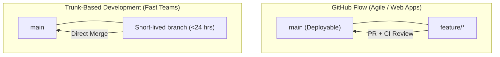

# 🌟 Best Practices & Professional Workflows

## 🎯 Topic: Industry Standards, Branching Models & Engineering Excellence

Writing good code is only half the battle. In top engineering organizations, writing clean commit messages, adopting predictable branching strategies, automating tests with CI/CD, and protecting critical branches are what differentiate amateur projects from professional software.

---

## 🌟 What You’ll Learn

By the end of this guide, you’ll master:
- ✅ The Conventional Commits 1.0 specification
- ✅ Comparing Branching Models: Git Flow vs GitHub Flow vs Trunk-Based Development
- ✅ Modern production CI/CD workflows with GitHub Actions
- ✅ Repository Governance: Branch Protection Rules and Repository Rulesets
- ✅ Semantic Versioning (SemVer) and Git Annotated Tags
- ✅ Code Review etiquette and Pull Request excellence

---

## ✍️ 1. Commit Message Architecture: Conventional Commits

Professional teams use [Conventional Commits](https://www.conventionalcommits.org/), which enables automated changelog generation and semantic version bumps.

### 📐 Standard Structure:
```text
<type>[optional scope]: <description>

[optional body explaining WHY this change was made]

[optional footer(s) such as BREAKING CHANGE or Closes #123]
```

### 🏷️ Standard Commit Types:
| Type | Purpose | Example |
|---|---|---|
| `feat` | A new user-facing feature | `feat(auth): add OAuth2 Google login button` |
| `fix` | A bug fix | `fix(cart): prevent negative discount calculation` |
| `docs` | Documentation only changes | `docs(readme): add installation guide for Windows` |
| `style` | Formatting/whitespace, no code logic change | `style: reformat with Prettier` |
| `refactor` | Code change that neither fixes bug nor adds feature | `refactor(db): extract user query to repository class` |
| `perf` | Code change that improves performance | `perf(search): debounce autocomplete inputs by 300ms` |
| `test` | Adding missing tests or correcting existing tests | `test(api): add unit test for checkout endpoint` |
| `chore` | Changes to build process, deps, or repo configs | `chore(deps): update vite to v5.2` |

### 💡 Example of a Perfect Git Commit:
```text
feat(checkout): add support for Apple Pay

Enable one-click checkout for mobile Safari users using the Apple Pay
JavaScript API. Fall back gracefully to credit card input on unsupported
browsers.

Closes #142
```

---

## 🌿 2. Branching Strategies: Which One Fits Your Team?



### 1. GitHub Flow (Recommended for Most Teams & Web Apps):
- **Single Source of Truth:** `main` is always tested, stable, and ready for production.
- **Workflow:**
  1. Branch off `main` (`feature/search-filters`).
  2. Commit and push changes.
  3. Open a Pull Request for review and automated CI checks.
  4. Merge into `main` and deploy immediately.

### 2. Git Flow (Best for Scheduled Release Cycles / Mobile Apps):
- Uses dual long-lived branches: `main` (production releases) and `develop` (integration).
- Supporting branches: `feature/*` (branch from `develop`), `release/*` (freeze before production), and `hotfix/*` (urgent production patches).

### 3. Trunk-Based Development (Best for High-Velocity Teams):
- Developers merge small, frequent updates directly into `main` (or via short-lived branches lasting less than a day), guarded by automated tests and feature flags.

---

## 🚀 3. Production CI/CD with GitHub Actions

A professional project never merges code without automated verification. Below is a production-grade CI workflow:

```yaml
# .github/workflows/ci.yml
name: Continuous Integration

on:
  push:
    branches: [main, develop]
  pull_request:
    branches: [main]

# Security Best Practice: Restrict default permissions
permissions:
  contents: read

jobs:
  test:
    name: Lint, Build & Test
    runs-on: ubuntu-latest

    steps:
      - name: Checkout Code
        uses: actions/checkout@v4

      - name: Setup Node.js
        uses: actions/setup-node@v4
        with:
          node-version: 20
          cache: "npm"

      - name: Install Dependencies
        run: npm ci

      - name: Run Linter
        run: npm run lint --if-present

      - name: Run Test Suite
        run: npm test --if-present

      - name: Verify Build
        run: npm run build
```

---

## 🛡️ 4. Repository Security & Rulesets

Never allow direct pushes to your production branch.

### Configure Branch Protection Rules or Repository Rulesets:
1. Go to **Settings ⚙️** → **Rules** → **Rulesets** (or **Branches**).
2. Apply rule to branch: `main`.
3. Enable these guardrails:
   - ✅ **Require a pull request before merging** (minimum 1 approved review).
   - ✅ **Require status checks to pass before merging** (e.g. CI workflow must succeed).
   - ✅ **Require linear history** (enforce rebase or squash-merging).
   - ✅ **Block force pushes** (prevents catastrophic history rewrites).
   - ✅ **Require signed commits** (ensures commits genuinely come from authorized authors).

---

## 🏷️ 5. Semantic Versioning & Release Tags

Projects should mark release milestones using **Semantic Versioning (SemVer)**:
`MAJOR.MINOR.PATCH` (e.g. `v1.2.0`)
- **MAJOR:** Breaking API changes.
- **MINOR:** Backwards-compatible new features.
- **PATCH:** Backwards-compatible bug fixes.

### Always use Annotated Tags (stores author, date, and message):
```bash
# Create annotated tag
git tag -a v1.2.0 -m "Release v1.2.0: Add modern Git commands and rescue workflows"

# Inspect tag details
git show v1.2.0

# Push tag to GitHub
git push origin v1.2.0
```

---

## 🤝 6. Pull Request & Code Review Etiquette

### For PR Authors:
- **Keep PRs small:** Small PRs (under 300 lines) are reviewed 5x faster and catch more bugs.
- **Self-Review First:** Read your own diff on GitHub before requesting reviews.
- **Provide Context:** Explain *why* the change was made, include before/after screenshots for UI changes, and link related issues (`Closes #42`).

### For Code Reviewers:
- Be constructive and polite.
- Separate blockers (bugs/security issues) from minor suggestions (styling/nits).
- Label suggestions clearly: `nit: consider renaming this variable for clarity`.

---

## 🏆 Recap & Next Steps

Following these professional practices elevates your projects into industry-grade, maintainable software systems!

➡️ **Next Guide:** [Advanced Tips, Troubleshooting & Productivity Hacks](Advanced%20Tips,%20Troubleshooting%20&%20Productivity%20Hacks.md) — Master command aliases, expert productivity tips, and daily developer shortcuts.
