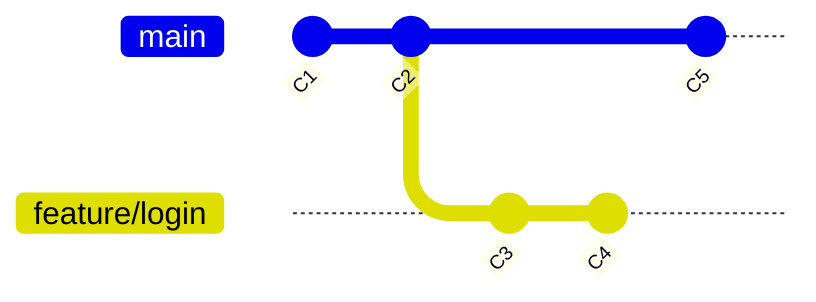
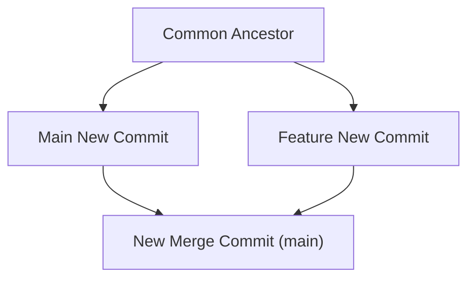

# 🌿 Branching and Merging

## 🎯 Topic: Branching Strategies, Merges & Conflict Resolution

In Git, branches are lightweight pointers to commits. They allow multiple developers (or a single developer working on multiple tasks) to work in complete isolation without disrupting the main codebase.

---

## 🌟 What You’ll Learn

By the end of this guide, you’ll master:
- ✅ Branch concepts and internal pointers (`HEAD` and branch references)
- ✅ Modern branch management (`git switch`, `git switch -c`, `git branch -vv`)
- ✅ Safe branch deletion (`git branch -d`) vs force deletion (`git branch -D`)
- ✅ Fast-Forward vs 3-Way (ORT) Merge mechanics
- ✅ Step-by-step merge conflict reproduction and resolution
- ✅ Safely canceling bad merges (`git merge --abort`)
- ✅ Professional branch naming conventions

---

## 🧩 How Branches Work in Git

Unlike older VCS systems that copy whole folders, a Git branch is simply a **40-character SHA pointer** that moves forward automatically whenever you make a new commit.



In the diagram above, `main` and `feature/login` share a common ancestor commit (`C2`), but have diverged with independent commits.

---

## 🌱 1. Inspecting Branches

### View local branches:
```bash
git branch
```
The active branch is highlighted with an asterisk `*` and green text.

### View all branches (local + remote tracking):
```bash
git branch -a
```

### 🔍 Pro Command: Inspect Upstream Tracking and Commit Ahead/Behind Counts
```bash
git branch -vv
```
✅ **Output Example:**
```text
* main           5a0e23d [origin/main: ahead 1] feat: add login
  feature/navbar 1b8f42a [origin/feature/navbar] docs: update header
```
*Notice how it shows whether your local branch is ahead, behind, or in sync with GitHub!*

---

## 🌿 2. Modern Branch Creation & Navigation

> [!TIP]
> Use `git switch` instead of `git checkout` for branch switching. It was created specifically to avoid accidental file overwrites.

### 🆕 Create and switch to a branch in one step:
```bash
git switch -c feature/shopping-cart
```
*(Classic equivalent: `git checkout -b feature/shopping-cart`)*

### 🔀 Switch to an existing local branch:
```bash
git switch feature/shopping-cart
```
*(Classic equivalent: `git checkout feature/shopping-cart`)*

### 🔙 Switch back to the previous branch:
```bash
git switch -
```

---

## 🔀 3. Merging Branches: Fast-Forward vs 3-Way Merge

When integrating changes from a feature branch back into `main`, Git performs either a **Fast-Forward** merge or a **3-Way (No-Fast-Forward)** merge.

### ⚡ Scenario A: Fast-Forward Merge
Occurs when no new commits have been made on `main` since the feature branch was created. Git simply moves the `main` pointer forward.

```mermaid
flowchart LR
    subgraph Before["Before Fast-Forward"]
        A1[Commit A] --> B1[Commit B (main)]
        B1 --> C1[Commit C (feature)]
    end
    subgraph After["After git merge feature"]
        A2[Commit A] --> B2[Commit B]
        B2 --> C2["Commit C (main, feature)"]
    end
```

Command:
```bash
git switch main
git merge feature/shopping-cart
```

### 🔀 Scenario B: 3-Way (Recursive / ORT) Merge
Occurs when both `main` and `feature` have new, diverging commits. Git finds the **common ancestor**, compares the changes, and creates a new **merge commit** uniting both histories.



To enforce creating a merge commit even if a fast-forward is possible (standard in team environments to preserve branch history):
```bash
git merge --no-ff feature/shopping-cart -m "merge: integrate feature/shopping-cart"
```

---

## 💥 4. Handling Merge Conflicts Like a Pro

A merge conflict happens when Git cannot automatically resolve differences between two branches — for example, if the same line of code in the same file was edited differently on both branches.

### 🚨 What a Conflict Looks Like:
When running `git merge`, Git reports:
```text
Auto-merging app.js
CONFLICT (content): Merge conflict in app.js
Automatic merge failed; fix conflicts and then commit the result.
```

If you open `app.js`, Git inserts conflict markers:

```javascript
<<<<<<< HEAD
const API_URL = "https://production.api.com";
=======
const API_URL = "https://staging.api.com";
>>>>>>> feature/api-update
```

### 🔍 Anatomy of Conflict Markers:
- `<<<<<<< HEAD`: Content in your current branch (`main`).
- `=======`: The divider separating conflicting versions.
- `>>>>>>> feature/api-update`: Content coming from the branch being merged.

### 🛠️ Step-by-Step Resolution:
1. Open the file in VS Code or your preferred editor.
2. Decide what the final code should be (keep current, keep incoming, or combine both).
3. **Delete all conflict marker lines** (`<<<<<<<`, `=======`, `>>>>>>>`).
4. Save the file.
5. Mark as resolved by staging:
   ```bash
   git add app.js
   ```
6. Complete the merge commit:
   ```bash
   git commit -m "fix(merge): resolve API_URL conflict between main and api-update"
   ```

### 🛑 Aborting a Conflicted Merge:
If you find yourself in over your head or want to back out safely:
```bash
git merge --abort
```
This restores your repository exactly to the state it was in before you ran `git merge`.

---

## 🧹 5. Deleting Branches Safely

Once a branch is merged into `main` and pushed to GitHub, delete it locally and remotely to prevent clutter.

### 🗑️ Safe Delete (Fails if branch has unmerged work):
```bash
git branch -d feature/shopping-cart
```

### ⚠️ Force Delete (Deletes even if unmerged):
```bash
git branch -D feature/shopping-cart
```
> [!WARNING]
> Only use `git branch -D` if you intentionally want to discard all work on that branch.

### 🌐 Delete a Remote Branch on GitHub:
```bash
git push origin --delete feature/shopping-cart
```

---

## 🧭 Professional Branch Naming Standards

In real engineering teams, use structured prefixes:

| Category | Format | Example |
|---|---|---|
| **New Features** | `feature/<short-desc>` | `feature/oauth2-login` |
| **Bug Fixes** | `bugfix/<issue-number>-<desc>` | `bugfix/issue-104-nav-overflow` |
| **Hotfixes (Prod)** | `hotfix/<version-or-desc>` | `hotfix/security-patch-v1.2.1` |
| **Documentation** | `docs/<desc>` | `docs/update-api-endpoints` |
| **Refactoring** | `refactor/<desc>` | `refactor/clean-auth-middleware` |

---

## 🧩 Branching Commands Cheat Sheet

| Task | Modern Command | Classic Command |
|---|---|---|
| Create & switch | `git switch -c <name>` | `git checkout -b <name>` |
| Switch branch | `git switch <name>` | `git checkout <name>` |
| Switch to previous | `git switch -` | `git checkout -` |
| Detailed branch list | `git branch -vv` | — |
| Abort bad merge | `git merge --abort` | — |
| Safe branch delete | `git branch -d <name>` | — |
| Force branch delete | `git branch -D <name>` | — |
| Delete remote branch | `git push origin --delete <name>` | — |

---

## 🏆 Recap & Next Steps

You can now branch, merge, handle conflicts, and keep your Git repository organized like a senior engineer!

➡️ **Next Guide:** [Working with Remote Repositories](Working%20with%20Remote%20Repositories.md) — Connect your local work to GitHub, manage tracking branches, and synchronize across teams.
