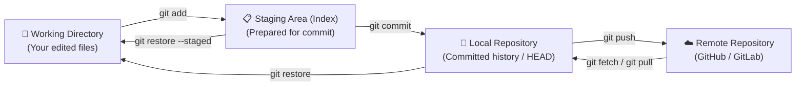

# 🧠 Git Commands with Examples

## 🎯 Topic: Essential Git Commands for Daily Use

Welcome to the command center of **Zero-to-GitHero**! 🚀 This guide covers the essential Git commands you will use every day as a developer — featuring both classic commands and **modern Git standards** (`git switch`, `git restore`).

---

## 🌟 What You’ll Learn

By the end of this guide, you’ll master:
- ✅ The 4 areas of Git (Working Tree, Staging, Local Repo, Remote Repo)
- ✅ Initializing and checking repository status (`git init`, `git status -sb`)
- ✅ Staging changes precisely (`git add`, `git add -p`)
- ✅ Committing and inspecting history (`git commit`, `git log`, `git show`)
- ✅ Modern branch navigation (`git switch`, `git switch -c`)
- ✅ Moving and removing files cleanly (`git mv`, `git rm`)
- ✅ Comparing changes (`git diff`, `git diff --staged`)
- ✅ Safely undoing unstaged and staged changes (`git restore`, `git reset`)
- ✅ Synchronizing with remotes (`git remote`, `git push`, `git pull`, `git clone`)

---

## 🗺️ Visualizing the Git Architecture

Before typing commands, understand how your files flow through the four states in Git:



---

## ⚙️ 1. `git init` — Initialize a Repository

Creates a brand new local Git repository in your current project folder.

```bash
git init
```

✅ **Output Example:**
```text
Initialized empty Git repository in /projects/my-app/.git/
```

💡 **Pro Tip:** In modern Git, you can set your default branch name on initialization:
```bash
git init -b main
```

---

## 🧐 2. `git status` — Check Repository Status

Displays which files have been modified, staged, or are currently untracked.

```bash
git status
```

✅ **Standard Output:**
```text
On branch main
Untracked files:
  (use "git add <file>..." to include in what will be committed)
        index.html
```

### ⚡ Shortcut: Concise Status (`-sb`)
For a fast, compact view showing the current branch and status flags:

```bash
git status -sb
```

✅ **Concise Output:**
```text
## main
?? index.html
 M style.css
A  app.js
```
*(Legend: `??` = untracked, `M` = modified, `A` = added/staged)*

---

## 🗃️ 3. `git add` — Stage Changes for Commit

Moves changes from your **Working Directory** to the **Staging Area (Index)**.

### Stage a specific file:
```bash
git add index.html
```

### Stage all modified and new files:
```bash
git add .
```

### 🎯 Pro Technique: Interactive Hunk Staging (`-p`)
Need to commit only part of a file rather than all your changes at once? Use patch mode:

```bash
git add -p script.js
```
Git will display each change "hunk" and ask you:
`Stage this hunk [y,n,q,a,d,s,e,?]?` (Press `y` to stage it, or `n` to skip).

---

## 💾 4. `git commit` — Save a Snapshot to History

Records the staged changes into the local repository with an informative message.

```bash
git commit -m "feat: add responsive navbar and logo"
```

✅ **Output Example:**
```text
[main 5a0e23d] feat: add responsive navbar and logo
 2 files changed, 45 insertions(+)
 create mode 100644 index.html
 create mode 100644 style.css
```

### 💡 Amend the last commit (fix typo / add forgotten file):
```bash
git add forgotten-file.css
git commit --amend --no-edit
```
> [!WARNING]
> Only amend commits that have **not** been pushed to a shared remote repository.

---

## 🕰️ 5. `git log` — View Commit History

Displays a chronological list of commits in your current branch.

```bash
git log
```

### 🎨 Pro Log View (One-line graphical tree):
```bash
git log --oneline --graph --decorate --all
```

✅ **Output Example:**
```text
* 5a0e23d (HEAD -> main) feat: add responsive navbar
* 1b8f42a docs: initial readme
* 90c7e31 chore: initial commit
```
*(Press `q` anytime to exit the log view).*

---

## 🔍 6. `git show` — Inspect a Specific Commit or Object

Shows the metadata and full diff of a commit or tag.

```bash
git show HEAD
# or by commit hash
git show 5a0e23d
```

---

## 🌿 7. Modern Branch Navigation: `git switch` vs `git checkout`

> [!NOTE]
> Historically, `git checkout` handled both switching branches and undoing files. In Git 2.23+, Git introduced `git switch` (for branches) and `git restore` (for files) to make commands clearer and safer.

### 🔀 Switch to an existing branch:
```bash
git switch feature/login
```
*(Classic equivalent: `git checkout feature/login`)*

### 🆕 Create and switch to a new branch in one command:
```bash
git switch -c feature/dashboard
```
*(Classic equivalent: `git checkout -b feature/dashboard`)*

### 🔙 Switch back to the previous branch:
```bash
git switch -
```

### 📋 List all local branches:
```bash
git branch
```

### 🔍 List all branches with tracking & commit details:
```bash
git branch -vv
```

---

## 🔀 8. `git merge` — Combine Branches

Merges history from another branch into your currently checked-out branch.

```bash
# 1. Switch to the target branch
git switch main

# 2. Merge feature branch into main
git merge feature/dashboard
```

### 🛑 Abort a conflicting merge:
If a merge results in conflicts and you want to safely back out to the pre-merge state:
```bash
git merge --abort
```

---

## 🔎 9. `git diff` — Inspect Changes

### Compare working directory changes against staging:
```bash
git diff
```

### Compare staged changes against the last commit (`HEAD`):
```bash
git diff --staged
```

### Compare two branches:
```bash
git diff main..feature/dashboard
```

---

## 🧽 10. Modern Undoing: `git restore` vs `git reset`

### 🩹 Discard local unstaged changes in a file:
```bash
git restore index.html
```
> [!WARNING]
> Discarding unstaged changes cannot be undone by Git! Ensure you don't need those edits before running `git restore`.

### ↩️ Unstage a file (keep local modifications intact):
```bash
git restore --staged index.html
```
*(Classic equivalent: `git reset HEAD index.html`)*

### ⚠️ Resetting the Staging Area / Commits:
```bash
# Unstage everything without touching files:
git reset

# Soft reset (moves HEAD back 1 commit, keeps changes staged):
git reset --soft HEAD~1

# Hard reset (DANGEROUS: wipes commits and working files back 1 commit):
git reset --hard HEAD~1
```

---

## 📁 11. `git rm` & `git mv` — File Operations

### Remove a file from disk and stage the removal:
```bash
git rm old-file.txt
```

### Stop tracking a file without deleting it from your computer:
*(Perfect for files you accidentally tracked before adding to `.gitignore`)*
```bash
git rm --cached .env
```

### Rename or move a tracked file:
```bash
git mv old-name.js new-name.js
```
Git automatically detects this as a rename in your staged changes!

---

## 🌍 12. Remote Synchronization (`remote`, `push`, `pull`, `clone`)

### Connect local repository to GitHub:
```bash
git remote add origin https://github.com/<username>/my-repo.git
```

### Check configured remotes:
```bash
git remote -v
```

### Push branch and set upstream tracking (`-u`):
```bash
git push -u origin main
```
*(Subsequent pushes only require typing `git push`)*

### Fetch latest updates without merging:
```bash
git fetch origin
```

### Pull and integrate remote changes:
```bash
git pull origin main
```

### Clone an existing repository from GitHub:
```bash
git clone https://github.com/<username>/my-repo.git
```

---

## 🧩 Comprehensive Quick Reference Table

| Category | Modern Command | Classic Equivalent | Description |
|---|---|---|---|
| **Branching** | `git switch <branch>` | `git checkout <branch>` | Switch to an existing branch |
| **Branching** | `git switch -c <branch>` | `git checkout -b <branch>` | Create and switch to new branch |
| **Branching** | `git switch -` | `git checkout -` | Switch to previous branch |
| **Undoing** | `git restore <file>` | `git checkout -- <file>` | Discard unstaged changes in working tree |
| **Undoing** | `git restore --staged <file>` | `git reset HEAD <file>` | Unstage file (keep working tree changes) |
| **Staging** | `git add -p <file>` | — | Interactively stage individual hunks |
| **Status** | `git status -sb` | — | Concise branch status with symbol flags |
| **Diff** | `git diff --staged` | `git diff --cached` | Compare staged changes with HEAD |
| **Inspecting**| `git show <commit>` | — | Show commit metadata and diff |
| **Files** | `git rm --cached <file>` | — | Untrack file without deleting from disk |
| **Files** | `git mv <old> <new>` | — | Move or rename tracked file |
| **Merge** | `git merge --abort` | — | Cancel merge in progress and reset state |

---

## 🎯 Hands-On Practice Exercise

Try this 5-minute drill in a temporary folder:
1. Initialize a repository: `git init practice-repo && cd practice-repo`
2. Create `hello.txt` with the text `"Hello Git"`.
3. Check status: `git status -sb`
4. Stage and commit: `git add hello.txt && git commit -m "feat: initial commit"`
5. Create and switch to branch: `git switch -c feature/test`
6. Edit `hello.txt`, test `git diff`, and unstage using `git restore --staged` if staged.
7. Switch back to main: `git switch main`

---

## 🏆 Recap & Next Steps

You now know both the foundational commands and the modern Git 2.23+ standards used in top software engineering teams!

➡️ **Next Guide:** [Branching and Merging](Branching%20and%20Merging.md) — Master branching strategies, tracking branches, fast-forward vs 3-way merges, and conflict resolution!
