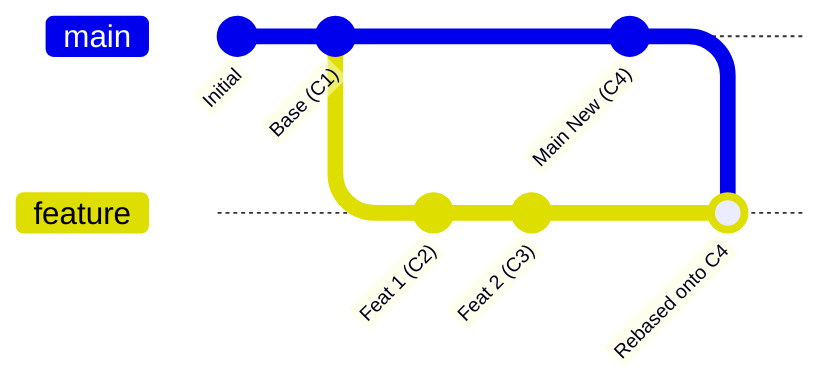
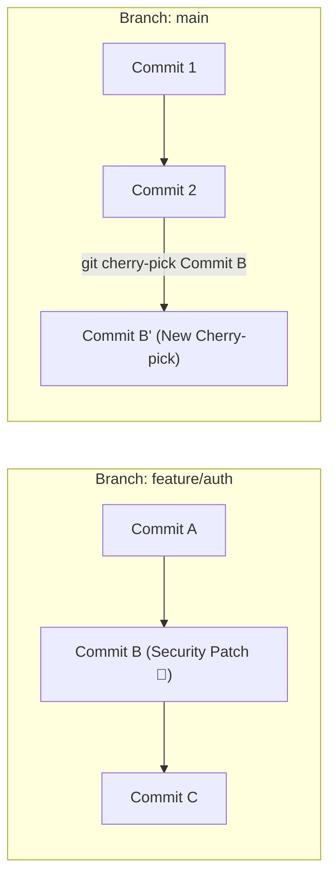

# 🚀 Git Rebase & Cherry-pick

## 🎯 Topic: Linear History, Interactive Squashing & Selective Commits

Two of the most powerful tools in a senior developer's toolkit are **Git Rebase** and **Git Cherry-pick**. They allow you to maintain a clean, readable, linear git history and move commits precisely across branches.

---

## 🌟 What You’ll Learn

By the end of this guide, you’ll master:
- ✅ The mechanics of Rebasing vs Merging
- ✅ How rebasing calculates new commit SHAs
- ✅ Step-by-step Interactive Rebase (`git rebase -i` with `squash`, `fixup`, `reword`)
- ✅ The Golden Rule of Rebasing (and avoiding team disaster)
- ✅ Comparing pre- and post-rebase histories with `git range-diff`
- ✅ Cherry-picking single commits, ranges, and using `-x` provenance flags
- ✅ Handling conflicts during rebase and cherry-pick (`--continue`, `--abort`)

---

## 🔄 1. Git Rebase: What Actually Happens?

When you run `git merge`, Git creates a new merge commit combining two diverging lines of history.

When you run `git rebase main`, Git does something fundamentally different:
1. Temporarily unplugs all commits unique to your feature branch.
2. Fast-forwards your feature branch to the latest commit on `main`.
3. Re-applies your commits **one by one** on top of the new base.

Because each re-applied commit now has a different parent commit, **every rebased commit receives a brand new SHA hash**.



---

## ⚙️ Standard Rebase Workflow

When your feature branch is ready, but `main` has moved ahead:

```bash
# 1. Ensure your local main is up to date
git switch main
git pull origin main

# 2. Switch back to your feature branch
git switch feature/payment-gateway

# 3. Rebase your feature branch on top of main
git rebase main
```

### 🛑 Resolving Rebase Conflicts:
If conflicts occur, Git pauses at the conflicting commit:
1. Open the conflicting files and resolve the markers (`<<<<<<<`, `=======`, `>>>>>>>`).
2. Stage the resolved files: `git add <file>`
3. Continue the rebase:
   ```bash
   git rebase --continue
   ```
4. If things get tangled, safely return to where you started:
   ```bash
   git rebase --abort
   ```

---

## 🎛️ 2. Interactive Rebase (`git rebase -i`)

Interactive rebasing lets you curate your commit history before submitting a Pull Request, turning 10 messy WIP commits into 2 clear, polished commits.

```bash
git rebase -i HEAD~4
```

Git will open your editor with an interactive command sheet:

```text
pick 1a2b3c4 feat: add checkout button
pick 5d6e7f8 fix typo in button styles
pick 9a0b1c2 wip: save cart state
pick 3e4f5a6 feat: add stripe payment handler

# Commands:
# p, pick <commit> = use commit
# r, reword <commit> = use commit, but edit the commit message
# e, edit <commit> = use commit, but stop for amending
# s, squash <commit> = use commit, but meld into previous commit
# f, fixup <commit> = like "squash", but discard this commit's log message
# d, drop <commit> = remove commit
```

### 💡 Example: Clean Up with `squash` and `fixup`
Change the verbs in your editor:
```text
pick 1a2b3c4 feat: add checkout button
fixup 5d6e7f8 fix typo in button styles
squash 9a0b1c2 wip: save cart state
pick 3e4f5a6 feat: add stripe payment handler
```
Save and close the file. Git will squash the minor typo fix and WIP state cleanly into the main feature commit!

---

## 🔍 Pro Tip: Verify Changes with `git range-diff`

How do you verify you didn't accidentally drop code during a complex rebase? Git provides `git range-diff` to compare the commit series before and after:

```bash
git range-diff origin/feature/payment-gateway..HEAD
```
This shows an exact diff of the commits themselves, giving you total confidence before pushing!

---

## ⚠️ The Golden Rule of Rebasing

> [!CAUTION]
> **Never rebase a branch that is shared with other developers or deployed to production (e.g., `main`, `master`, `dev`).**
> Because rebasing generates new commit hashes, rebasing a shared branch forces everyone else on the team to manually reconstruct their local histories.
> Only rebase your own local, unmerged feature branches!

---

## 🍒 3. Git Cherry-pick: Precision Commit Selection

`git cherry-pick` applies the changes introduced by an existing commit from another branch onto your current branch, without merging the whole branch.



### 🎯 Common Scenarios:
- **Urgent Hotfix:** A bug fix was made inside a large, unfinished feature branch, but needs to be deployed to `main` immediately.
- **Accidental Commit:** You made a commit on the wrong branch and want to re-apply it on the correct one.

### Basic Cherry-pick:
```bash
git switch main
git cherry-pick 5a0e23d
```

### 💡 Pro Tip: Preserve Origin with `-x`
Adding the `-x` flag automatically appends a message to the commit indicating where it was cherry-picked from:
```bash
git cherry-pick -x 5a0e23d
```
The resulting commit message will include:
`(cherry picked from commit 5a0e23d...)`

### Cherry-pick a range of commits:
```bash
# Applies commit B through D (inclusive):
git cherry-pick commitA..commitD
```

---

## 📚 Rebase & Cherry-pick Quick Reference

| Command | Action |
|---|---|
| `git rebase <base>` | Replay current branch commits onto `<base>` |
| `git rebase -i HEAD~N` | Interactively modify the last `N` commits |
| `git rebase --continue` | Proceed to next commit after resolving conflict |
| `git rebase --abort` | Cancel rebase and restore original state |
| `git range-diff <old>..<new>` | Compare commit series diffs across rebases |
| `git cherry-pick <hash>` | Apply specified commit to current HEAD |
| `git cherry-pick -x <hash>` | Apply commit with origin provenance record |
| `git cherry-pick --abort` | Cancel cherry-pick in progress |

---

## 🏆 Recap & Next Steps

You can now keep your commit histories pristine, squash messy drafts, and selectively transplant critical commits across branches!

➡️ **Next Guide:** [Hosting Websites with GitHub Pages](Hosting%20Websites%20with%20GitHub%20Pages.md) — Master static hosting, GitHub Actions deployment, custom domains, and framework exports.
