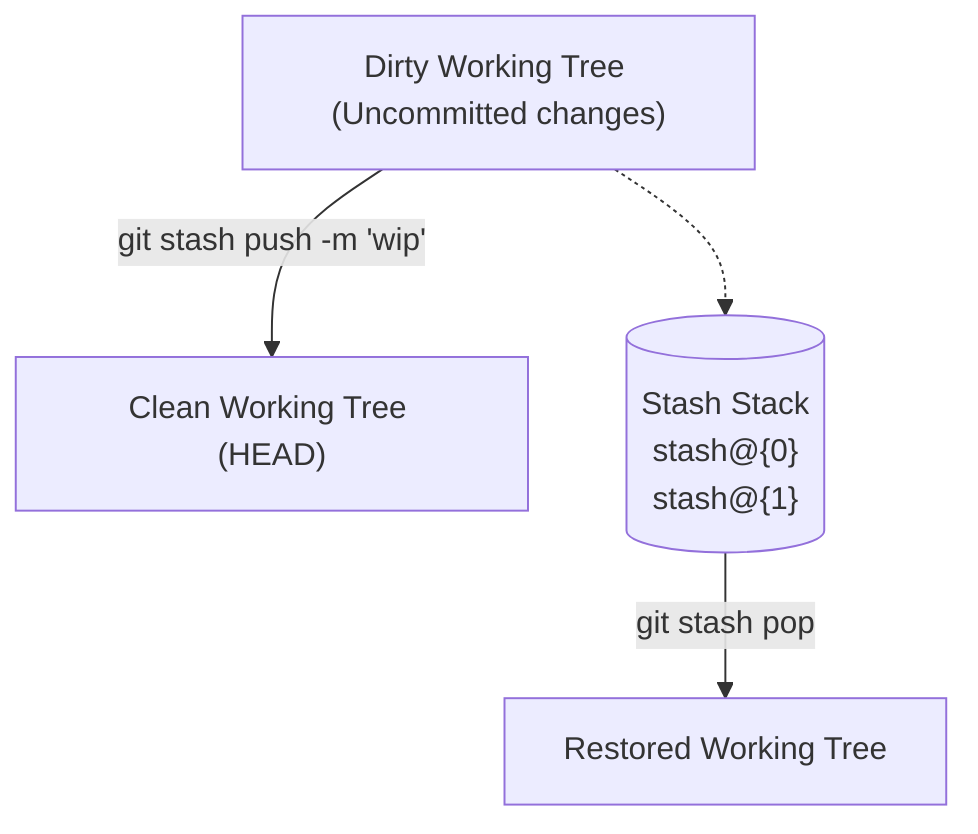
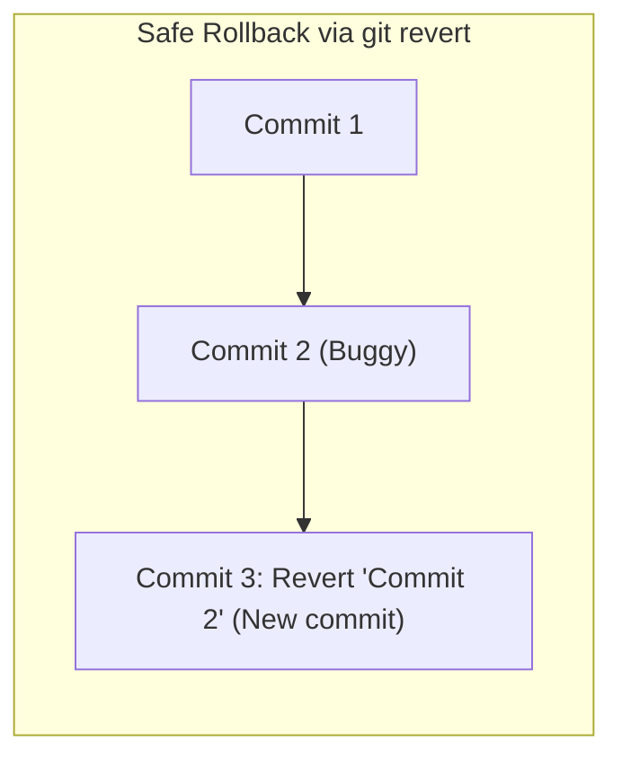

# 🌟 Git Stash & Revert

## 🎯 Topic: Temporary Work Stashing & Non-Destructive History Rollbacks

In software development, interruptions are inevitable: an urgent hotfix is needed while you are in the middle of a complex feature, or a bad commit reaches a shared branch. 

**Git Stash** and **Git Revert** are your essential safety tools.

---

## 🌟 What You’ll Learn

By the end of this guide, you’ll master:
- ✅ Temporarily shelving changes with descriptive messages (`git stash push -m`)
- ✅ Stashing untracked and new files (`git stash -u`)
- ✅ Interactive patch stashing (`git stash -p`)
- ✅ Applying, dropping, and popping stashed states
- ✅ Spawning a branch directly from a stash (`git stash branch`)
- ✅ The fundamental difference between `git revert` and `git reset`
- ✅ Safely rolling back production commits on shared branches

---

## 🧳 1. Git Stash — Your Code Clipboard

`git stash` takes your uncommitted modifications (both staged and unstaged), records them onto an internal stack, and restores your working directory to match the clean `HEAD` commit.



---

## 🧩 Stash Commands & Real-World Use Cases

### 1. The Standard Stash:
```bash
git stash
```

### 2. Modern Descriptive Stash (Highly Recommended):
By default, Git auto-generates a generic message like `WIP on main...`. Always give your stash a meaningful name:
```bash
git stash push -m "wip: shopping cart discount calculation"
```

### 3. Stashing Untracked Files (`-u` / `--include-untracked`):
> [!IMPORTANT]
> By default, `git stash` ignores newly created files that haven't been staged yet (`git add`). If you created new files, you **must** use `-u` so they aren't left behind:
```bash
git stash -u -m "wip: new auth service and mock tests"
```

### 4. Interactive Patch Stash (`-p`):
Stash only selected change hunks while keeping the rest in your working directory:
```bash
git stash -p
```

### 5. Inspecting Stash Contents:
```bash
# List all stashed entries
git stash list

# View summary of files in latest stash
git stash show

# View full diff of a specific stash
git stash show -p stash@{0}
```

### 6. Restoring Stashed Work:
- **`git stash pop`**: Restores the latest stash (`stash@{0}`) and immediately deletes it from the stash stack.
- **`git stash apply`**: Restores the latest stash but **keeps** it safely on the stash stack (useful if you want to apply the same changes to multiple branches).
- **Apply specific stash**: `git stash apply stash@{1}`

### 7. Branching from a Stash (`git stash branch`):
If your branch has moved forward significantly and applying a stash causes conflicts, create a new branch starting from the exact commit where you originally stashed:
```bash
git stash branch recovery-branch stash@{0}
```

### ⚠️ Warning: `git stash clear`
> [!CAUTION]
> `git stash clear` deletes **all** stashes permanently across your entire repository. If you only want to remove one stash, use `git stash drop stash@{0}`.

---

## 🕓 2. Git Revert — Safe History Rollbacks

When a bug is pushed to a shared remote branch (`main`), how do you undo it?

- **`git reset`** rewrites history by moving the branch pointer backwards (dangerous on shared branches, requires `--force`).
- **`git revert`** creates a **new commit** that introduces the exact inverse of the bad commit (safe for team collaboration).



---

## 🛠️ How to Use `git revert`

### Revert the most recent commit:
```bash
git revert HEAD
```
Git will open your editor to let you review the auto-generated commit message:
`Revert "feat: add payment gateway"`

### Revert an older commit by hash:
```bash
git revert 5a0e23d
```

### Revert a range of commits:
```bash
git revert old_sha^..new_sha
```

### Revert without creating a commit immediately (`-n` / `--no-commit`):
If you want to un-apply multiple commits and combine the inversions into one single commit:
```bash
git revert -n commitA
git revert -n commitB
git commit -m "fix: revert failed analytics migration"
```

---

## ⚡ Reset vs Revert: When to Use Which?

| Feature | `git reset` | `git revert` |
|---|---|---|
| **What it does** | Moves the branch pointer backward | Adds a new commit undoing previous diffs |
| **Rewrites history?** | ✅ Yes | ❌ No |
| **Safe for remote/shared branches?** | ❌ Never (breaks teammates' repos) | ✅ Yes (standard practice) |
| **Best used for** | Private, unpushed local commits | Public commits already on GitHub |

---

## 📚 Quick Reference Table

| Command | Action |
|---|---|
| `git stash push -u -m "msg"` | Stash tracked & untracked files with custom label |
| `git stash list` | View all stashed states |
| `git stash pop` | Apply and remove latest stash |
| `git stash apply <stash_id>` | Apply stash without deleting it |
| `git stash drop <stash_id>` | Delete a specific stash |
| `git stash clear` | Delete ALL stashes (destructive) |
| `git stash branch <name>` | Create a new branch directly from stashed changes |
| `git revert <commit_hash>` | Create a new commit that inverts a target commit |
| `git revert --no-commit <hash>` | Invert changes in working tree without auto-committing |

---

## 🏆 Recap & Next Steps

You now possess the tools to pause your work cleanly without making premature commits, and safely roll back problematic code on production branches without rewriting history!

➡️ **Next Guide:** [Git Rebase & Cherry-pick](Git%20Rebase%20&%20Cherry-pick.md) — Master linear history, interactive squashing, and cherry-picking individual commits across branches.
