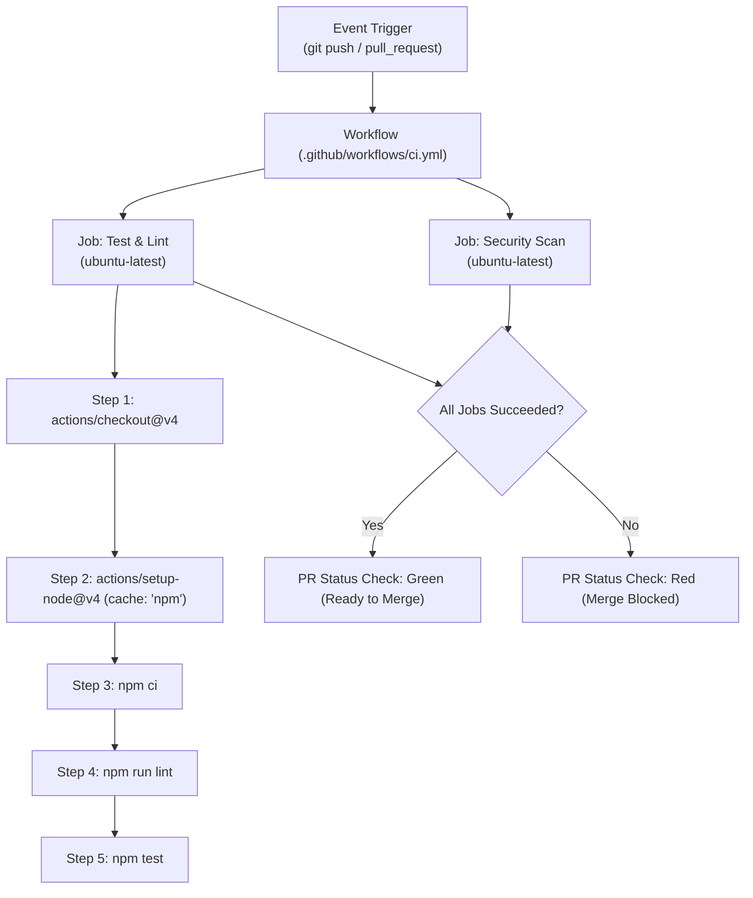

# 🚀 GitHub Actions & CI/CD Pipelines

## 🎯 Topic: Continuous Integration, Automated Testing & Deployment Workflows

**GitHub Actions** is GitHub's native continuous integration and continuous delivery (CI/CD) platform. It allows you to automate software builds, run test suites on every pull request, enforce code quality standards, scan for vulnerabilities, and deploy applications automatically when changes are merged.

---

## 🌟 What You’ll Learn

By the end of this guide, you’ll master:
- ✅ Core architecture of GitHub Actions (Workflows, Events, Jobs, Steps, Runners)
- ✅ Modern, secure CI workflows using maintained actions (`actions/checkout@v4`, `actions/setup-node@v4`)
- ✅ Why `npm ci` is required instead of `npm install` in CI environments
- ✅ Least-privilege workflow permissions (`permissions: read-all`)
- ✅ Dependency caching for faster builds
- ✅ Matrix testing across multiple operating systems and runtime versions
- ✅ Encrypted Secrets and Environment variables
- ✅ Inspecting, debugging, and resolving failed workflow runs

---

## 🗺️ Visualizing the CI/CD Pipeline



---

## ⚙️ 1. Core Concepts Explained

| Concept | Description |
|---|---|
| **Workflow** | An automated configurable process made of one or more jobs, defined in YAML in `.github/workflows/`. |
| **Event / Trigger** | A specific activity that triggers the workflow (e.g. `push`, `pull_request`, `schedule`, `workflow_dispatch`). |
| **Job** | A set of steps executed sequentially on the same runner virtual machine. Multiple jobs run in parallel by default. |
| **Step** | An individual task within a job — either running a shell command (`run: ...`) or an action (`uses: ...`). |
| **Action** | A reusable application or script component (e.g. `actions/checkout@v4`). |
| **Runner** | A GitHub-hosted or self-hosted virtual machine that executes your jobs (`ubuntu-latest`, `windows-latest`, `macos-latest`). |

---

## 🛠️ 2. Production-Grade CI Workflow Template

Create a file at `.github/workflows/ci.yml`:

```yaml
name: Continuous Integration

on:
  push:
    branches: [main, develop]
  pull_request:
    branches: [main]
  # Allows triggering the workflow manually from GitHub UI or GitHub CLI
  workflow_dispatch:

# SECURITY BEST PRACTICE: Restrict top-level token permissions
permissions:
  contents: read

# Concurrency: Cancel redundant in-progress runs when new commits are pushed to the same PR
concurrency:
  group: ${{ github.workflow }}-${{ github.ref }}
  cancel-in-progress: true

jobs:
  lint-and-test:
    name: Build, Lint & Test
    runs-on: ubuntu-latest
    timeout-minutes: 15

    steps:
      # Step 1: Checkout the repository code
      - name: Checkout Repository
        uses: actions/checkout@v4

      # Step 2: Setup Node.js runtime and enable built-in npm caching
      - name: Setup Node.js 20
        uses: actions/setup-node@v4
        with:
          node-version: 20
          cache: "npm"

      # Step 3: Clean, deterministic dependency installation
      - name: Install Dependencies
        run: npm ci

      # Step 4: Run code style and lint checks
      - name: Run Linter
        run: npm run lint --if-present

      # Step 5: Execute unit tests
      - name: Run Tests
        run: npm test --if-present

      # Step 6: Verify production build succeeds
      - name: Build Application
        run: npm run build --if-present
```

---

## 💡 3. Key Technical Details: Why Do We Write It This Way?

### 1. Why `npm ci` instead of `npm install`?
- `npm install` can update `package-lock.json` and install slightly different transitive dependency versions, leading to the dreaded "works on my machine, fails in CI" syndrome.
- `npm ci` (Clean Install) strictly requires an exact match between `package.json` and `package-lock.json`, deletes existing `node_modules`, and is up to **2x faster**.

### 2. Why specify `permissions: contents: read`?
- By default, GitHub Actions tokens have broad write permissions in some configurations. Setting explicit minimal permissions prevents compromised dependencies from tampering with your repository.

### 3. Why `timeout-minutes: 15`?
- Prevents infinite loops or hung tests from consuming your GitHub Actions billing minutes.

---

## 🧪 4. Matrix Builds: Testing Across Multiple Versions

Want to verify your library works across Node.js 18, 20, and 22, and on both Ubuntu and Windows? Use a **Matrix strategy**:

```yaml
jobs:
  matrix-test:
    name: Test Node ${{ matrix.node-version }} on ${{ matrix.os }}
    runs-on: ${{ matrix.os }}
    strategy:
      matrix:
        os: [ubuntu-latest, windows-latest]
        node-version: [18, 20, 22]

    steps:
      - uses: actions/checkout@v4
      - uses: actions/setup-node@v4
        with:
          node-version: ${{ matrix.node-version }}
          cache: "npm"
      - run: npm ci
      - run: npm test
```
GitHub Actions will automatically spawn 6 parallel virtual machines to test every permutation!

---

## 🔐 5. Handling Secrets & Environment Variables

Never hardcode API keys, passwords, or tokens in your repository or workflow files!

### 1. Add Secret on GitHub:
Go to **Settings ⚙️** → **Secrets and variables** → **Actions** → **New repository secret** (e.g. `CODECOV_TOKEN`).

### 2. Access Secret in Workflow:
```yaml
      - name: Upload Test Coverage
        env:
          CODECOV_TOKEN: ${{ secrets.CODECOV_TOKEN }}
        run: npm run test:coverage
```

---

## 🔍 6. Diagnosing and Debugging Failed Workflows

When a check fails on a Pull Request:
1. Click the red ❌ icon on the commit or PR check line.
2. Click **Details** to open the workflow run execution log.
3. Expand the failed step (e.g. `Run Tests`).
4. Read the stack trace to identify which test file or assertion failed.

### 💻 Debugging via GitHub CLI:
You don't even have to open the browser:
```bash
# List recent runs
gh run list

# Stream failed logs directly in terminal
gh run view <run-id> --log-failed

# Re-trigger only the failed jobs
gh run rerun <run-id> --failed
```

---

## 📚 CI/CD Actions Cheat Sheet

| Feature | Action / Syntax | Purpose |
|---|---|---|
| **Checkout Code** | `actions/checkout@v4` | Clone repo into runner workspace |
| **Node.js Setup** | `actions/setup-node@v4` | Install Node runtime with cache |
| **Python Setup** | `actions/setup-python@v5` | Install Python runtime with pip cache |
| **Upload Artifacts** | `actions/upload-artifact@v4` | Preserve test reports or build outputs |
| **Download Artifacts**| `actions/download-artifact@v4` | Pass build outputs to deployment jobs |
| **Trigger Manually**| `on: workflow_dispatch` | Adds a "Run workflow" button in UI |

---

## 🏆 Recap & Next Steps

You now know how to build, maintain, and secure professional continuous integration pipelines for any GitHub project!

➡️ **Next Guide:** [GitHub Security & Repository Management](GitHub%20Security%20&%20Repository%20Management.md) — Master repository rulesets, CODEOWNERS, Dependabot, and Secret Scanning.

