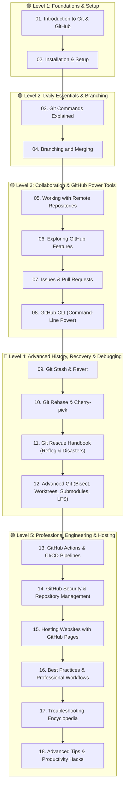

# 🚀 Zero-to-GitHero: The Complete Git & GitHub Guide

> **From Zero to Hero:** Master Git and GitHub with step-by-step tutorials, modern Git 2.40+ standards, disaster recovery techniques, professional CI/CD workflows, and quick-lookup cheat sheets! 💪

---

## 🎯 What Makes Zero-to-GitHero Different?

**Zero-to-GitHero** is not just another flat command cheat sheet. It is a structured, practical journey designed to guide you from initializing your first local repository all the way to handling complex merge conflicts, salvaging dropped commits with `git reflog`, debugging regressions with `git bisect`, and deploying production CI/CD pipelines.

- 🌿 **Modern Git Standards:** Covers modern commands (`git switch`, `git restore`, `git diff --staged`) alongside classic workflows.
- 🚑 **Git Rescue Handbook:** Complete guide on recovering from accidental `git reset --hard`, deleted branches, and detached HEAD states.
- 🪟 **Cross-Platform Compatibility:** Tested instructions for Windows PowerShell, Git Bash, and macOS/Linux.
- 🤖 **Industry Workflows:** Production-grade GitHub Actions CI/CD templates, Repository Rulesets, CODEOWNERS, and Dependabot.
- ⚡ **Quick Reference Cheat Sheets:** Instant cheat sheets for daily commands, disaster recovery, and GitHub CLI.

---

## 🗺️ Visual Learning Roadmap

---

## 📋 Comprehensive Table of Contents

### 🟢 Level 1: Foundations & Setup
1. [🧭 Introduction to Git and GitHub](Introduction%20to%20Git%20and%20GitHub.md) — What is Git/GitHub, version control basics, and terminology.
2. [⚙️ Setting Up Git and GitHub](Setting%20Up%20Git%20and%20GitHub.md) — Cross-platform installation, global config, SSH keys, and `core.autocrlf`.

### 🟢 Level 2: Core Git & Branching
3. [🧠 Git Commands Explained](Git%20Commands%20Explained.md) — Essential daily commands, modern `switch` & `restore`, interactive staging (`add -p`).
4. [🌿 Branching and Merging](Branching%20and%20Merging.md) — Feature branches, tracking branches (`-vv`), Fast-Forward vs 3-Way merges, and conflict resolution.

### 🟡 Level 3: Remotes & GitHub Collaboration
5. [🌍 Working with Remote Repositories](Working%20with%20Remote%20Repositories.md) — Remotes, `push -u`, `fetch --prune`, `pull --rebase`, and `--force-with-lease`.
6. [📘 Exploring GitHub Features](Exploring%20GitHub%20Features.md) — Repositories, forks, stars, discussions, and open-source contribution flow.
7. [🐛 Working with GitHub Issues & Pull Requests](Working%20with%20GitHub%20Issues%20&%20Pull%20Requests.md) — Bug tracking, review cycles, and draft PRs.
8. [💻 GitHub CLI (Command-Line Power)](GitHub%20CLI%20(Command-Line%20Power).md) — Terminal-first GitHub: `gh pr`, `gh release`, `gh run`, and `gh secret`.

### 🔴 Level 4: Advanced History, Recovery & Debugging
9. [🔄 Git Stash & Revert](Git%20Stash%20&%20Revert.md) — Shelving work (`stash -u/-p`), stashing to branches, and non-destructive rollbacks.
10. [🔀 Git Rebase & Cherry-pick](Git%20Rebase%20&%20Cherry-pick.md) — Linear history, interactive squashing (`rebase -i`), `range-diff`, and `cherry-pick -x`.
11. [🚑 Git Rescue Handbook](Git%20Rescue%20Handbook.md) — Recovering from `reset --hard`, restoring deleted branches, and `git reflog` wizardry.
12. [🔬 Advanced Git: Bisect, Worktrees, Submodules & LFS](Advanced%20Git%20-%20Bisect,%20Worktrees,%20Submodules%20&%20LFS.md) — Binary search bug hunting, multi-branch directories, and large files.

### 🟣 Level 5: Professional CI/CD, Security & Hosting
13. [🚀 GitHub Actions & CI/CD Pipelines](GitHub%20Actions%20&%20CI-CD.md) — Production automated testing, matrix builds, caching, and security permissions.
14. [🛡️ GitHub Security & Repository Management](GitHub%20Security%20&%20Repository%20Management.md) — Repository Rulesets, CODEOWNERS, Dependabot, and Secret Scanning.
15. [🌐 Hosting Websites with GitHub Pages](Hosting%20Websites%20with%20GitHub%20Pages.md) — Static hosting, Actions deployment, custom domains, and framework exports.
16. [✅ Best Practices & Professional Workflows](Best%20Practices%20&%20Professional%20Workflow.md) — Git Flow vs Trunk-Based, Conventional Commits, and PR etiquette.
17. [🔧 Troubleshooting Git & GitHub Issues](Troubleshooting%20Git%20&%20GitHub%20Issues.md) — Cross-platform diagnostic fixes for SSH, credentials, line-endings, and push rejections.
18. [⚡ Advanced Tips, Troubleshooting & Productivity Hacks](Advanced%20Tips,%20Troubleshooting%20&%20Productivity%20Hacks.md) — Shell aliases, Git hooks, and productivity shortcuts.

---

## ⚡ Quick-Lookup Cheat Sheets

Need an instant command reference while coding?
- 📖 [Git Core Commands Reference](cheat-sheets/git-commands.md) — Daily command syntax and flags.
- 🚑 [Git Disaster Recovery Reference](cheat-sheets/git-recovery.md) — The emergency "Oh Shit, Git!" one-liners.
- 💻 [GitHub CLI Reference](cheat-sheets/github-cli.md) — Essential `gh` terminal commands.

---

## 🤝 Contributing

We welcome contributions from developers of all experience levels!
- Read our [Contributing Guide](CONTRIBUTING.md) for branch guidelines, commit standards, and PR workflows.
- Please review our [Code of Conduct](CODE_OF_CONDUCT.md).
- Track version history and recent upgrades in [CHANGELOG.md](CHANGELOG.md).

---

## 📄 License

This project is open-source and available under the [MIT License](LICENSE).

---

## 🙏 Acknowledgments

- **Linus Torvalds** and the Git Core Team for creating Git.
- **GitHub** for revolutionizing developer collaboration.
- **Open Source Contributors** who keep documentation accurate and accessible.

---

**Ready to start your journey?**  
👉 **[Start Here: 🧭 Introduction to Git and GitHub](Introduction%20to%20Git%20and%20GitHub.md)**
