# Zero-to-GitHero: The Complete Git & GitHub Guide

> A practical, structured guide from initializing your first repository to mastering modern Git standards, disaster recovery with reflog, professional CI/CD pipelines, and GitHub CLI workflows.

---

## Visual Learning Roadmap

Follow the sequential 20-part curriculum designed to take you from foundational concepts to advanced engineering workflows:

```mermaid
flowchart TD
    subgraph Level1["Level 1: Foundations & Architecture"]
        01["01. Introduction to Git and GitHub"] --> 02["02. Setting Up Git and GitHub"]
        02 --> 03["03. Git Architecture and Fundamentals"]
        03 --> 04["04. Essential Git Commands"]
        04 --> 05["05. Inspecting Changes and History"]
    end

    subgraph Level2["Level 2: Branching & Remote Collaboration"]
        05 --> 06["06. Branching and Merging"]
        06 --> 07["07. Working with Remote Repositories"]
        07 --> 08["08. Exploring GitHub Features"]
        08 --> 09["09. Working with GitHub Issues & Pull Requests"]
        09 --> 10["10. GitHub CLI (Command-Line Power)"]
    end

    subgraph Level3["Level 3: History Rewriting & Recovery"]
        10 --> 11["11. Git Stash & Revert"]
        11 --> 12["12. Git Rebase & Cherry-pick"]
        12 --> 13["13. Git Rescue Handbook (Reflog & Disasters)"]
        13 --> 14["14. Advanced Git (Bisect, Worktrees, Submodules, LFS)"]
    end

    subgraph Level4["Level 4: Professional Engineering & Operations"]
        14 --> 15["15. GitHub Actions & CI-CD"]
        15 --> 16["16. GitHub Security & Repository Management"]
        16 --> 17["17. Hosting Websites with GitHub Pages"]
        17 --> 18["18. Best Practices & Professional Workflow"]
        18 --> 19["19. Troubleshooting Git & GitHub Issues"]
        19 --> 20["20. Advanced Tips, Troubleshooting & Productivity Hacks"]
    end
```

---

## Curriculum Table of Contents

All guides are numbered in chronological order of learning:

### Level 1: Foundations & Architecture
1. [01. Introduction to Git and GitHub](01.%20Introduction%20to%20Git%20and%20GitHub.md) — What is Git/GitHub, distributed version control, and terminology.
2. [02. Setting Up Git and GitHub](02.%20Setting%20Up%20Git%20and%20GitHub.md) — Installation across Windows, macOS, Linux, user identity, and SSH key authentication.
3. [03. Git Architecture and Fundamentals](03.%20Git%20Architecture%20and%20Fundamentals.md) — The 4 zones of Git, the Object model (blobs, trees, commits), and snapshots vs diffs.
4. [04. Essential Git Commands](04.%20Essential%20Git%20Commands.md) — Initializing repositories, status codes (`-sb`), patch staging (`add -p`), commits, and modern `git restore`.
5. [05. Inspecting Changes and History](05.%20Inspecting%20Changes%20and%20History.md) — Line-by-line diffs, staged comparisons, log trees, `git blame`, and `git grep`.

### Level 2: Branching & Remote Collaboration
6. [06. Branching and Merging](06.%20Branching%20and%20Merging.md) — Modern `git switch`, tracking branches (`-vv`), Fast-Forward vs 3-Way merges, and conflict resolution.
7. [07. Working with Remote Repositories](07.%20Working%20with%20Remote%20Repositories.md) — Remotes, `push -u`, `fetch --prune`, `pull --rebase`, and `--force-with-lease`.
8. [08. Exploring GitHub Features](08.%20Exploring%20GitHub%20Features.md) — Repositories, forks, discussions, and open-source contribution patterns.
9. [09. Working with GitHub Issues & Pull Requests](09.%20Working%20with%20GitHub%20Issues%20&%20Pull%20Requests.md) — Task tracking, PR review workflows, auto-closing keywords, and merge strategies.
10. [10. GitHub CLI (Command-Line Power)](10.%20GitHub%20CLI%20(Command-Line%20Power).md) — Terminal-first GitHub: `gh pr`, `gh release`, `gh run`, and secret management.

### Level 3: History Rewriting & Recovery
11. [11. Git Stash & Revert](11.%20Git%20Stash%20&%20Revert.md) — Shelving work (`stash -u/-p`), stashing to branches, and non-destructive rollbacks on shared branches.
12. [12. Git Rebase & Cherry-pick](12.%20Git%20Rebase%20&%20Cherry-pick.md) — Reapplying commits, interactive squashing (`rebase -i`), `range-diff`, and `cherry-pick -x`.
13. [13. Git Rescue Handbook](13.%20Git%20Rescue%20Handbook.md) — Recovering from `reset --hard`, restoring deleted branches, and `git reflog` diagnostics.
14. [14. Advanced Git - Bisect, Worktrees, Submodules & LFS](14.%20Advanced%20Git%20-%20Bisect,%20Worktrees,%20Submodules%20&%20LFS.md) — Binary search bug hunting, parallel workspaces with worktrees, submodules, and large file storage.

### Level 4: Professional Engineering & Operations
15. [15. GitHub Actions & CI-CD](15.%20GitHub%20Actions%20&%20CI-CD.md) — Production automated testing, matrix builds, caching, and minimal security permissions.
16. [16. GitHub Security & Repository Management](16.%20GitHub%20Security%20&%20Repository%20Management.md) — Repository Rulesets, CODEOWNERS, Dependabot alerts, Secret Scanning, and Codespaces.
17. [17. Hosting Websites with GitHub Pages](17.%20Hosting%20Websites%20with%20GitHub%20Pages.md) — Static hosting constraints, Actions-based deployment, custom domains, and framework exports.
18. [18. Best Practices & Professional Workflow](18.%20Best%20Practices%20&%20Professional%20Workflow.md) — GitHub Flow vs Trunk-Based Development, Conventional Commits, and SemVer release tags.
19. [19. Troubleshooting Git & GitHub Issues](19.%20Troubleshooting%20Git%20&%20GitHub%20Issues.md) — Cross-platform diagnostic fixes for SSH, credentials, line-endings (`CRLF`), and rejected pushes.
20. [20. Advanced Tips, Troubleshooting & Productivity Hacks](20.%20Advanced%20Tips,%20Troubleshooting%20&%20Productivity%20Hacks.md) — Useful aliases, Git autocorrect, global gitignores, and `git rerere`.

---

## GitHub Cheat Sheet

For instant reference during development, use the high-resolution light-theme cheat sheet below or browse the individual topic references:

- **Repository:** [Zero-to-GitHero](https://github.com/Tushar-cyber19/Zero-to-GitHero)
- **Developed by:** Tushar Manaktala ([@Tushar-cyber19](https://github.com/Tushar-cyber19))

### Text-Based Reference Guides:
- [Git Core Commands Cheat Sheet](cheat-sheets/git-commands.md)
- [Git Disaster Recovery Cheat Sheet](cheat-sheets/git-recovery.md)
- [GitHub CLI Reference Sheet](cheat-sheets/github-cli.md)

---

## Contributing

Contributions from developers of all experience levels are welcome.
- Please review our [Contributing Guide](CONTRIBUTING.md) for branch naming standards and PR guidelines.
- Adhere to the [Code of Conduct](CODE_OF_CONDUCT.md).
- View version history in [CHANGELOG.md](CHANGELOG.md).

---

## License

This project is licensed under the [MIT License](LICENSE).

---

**Begin Learning:**  
-> [01. Introduction to Git and GitHub](01.%20Introduction%20to%20Git%20and%20GitHub.md)
