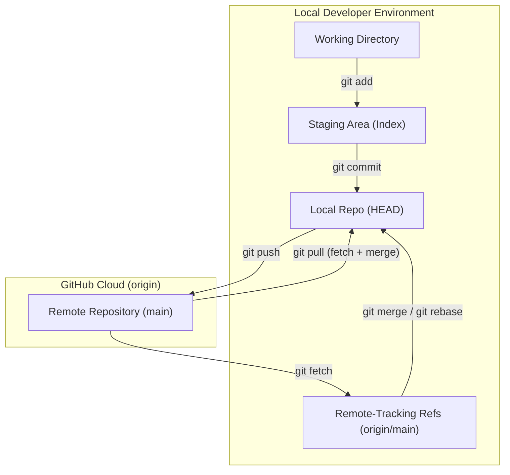

# 🌐 Working with Remote Repositories

## 🎯 Topic: Managing Remotes, Upstream Tracking & Team Synchronization

A **remote repository** is a version of your project hosted on a shared server — most commonly GitHub. Remotes enable team collaboration, code backup, and continuous deployment.

---

## 🌟 What You’ll Learn

By the end of this guide, you’ll master:
- ✅ Anatomy of local vs remote repositories
- ✅ Remote configuration (`git remote -v`, `add`, `remove`, `set-url`)
- ✅ The exact difference between `git fetch` and `git pull`
- ✅ Preventing messy merge bubbles with `git pull --rebase`
- ✅ Upstream tracking (`git push -u`, `git branch --set-upstream-to`)
- ✅ Cleaning up stale tracking branches with `git fetch --prune`
- ✅ Safe history synchronization (`git push --force-with-lease`)

---

## 🗺️ Remote Data Flow Architecture



---

## 🏠 1. Inspecting Remote Connections

To view the names and URLs of all configured remotes:

```bash
git remote -v
```

✅ **Output Example:**
```text
origin  https://github.com/username/my-project.git (fetch)
origin  https://github.com/username/my-project.git (push)
```

### Inspect detailed remote state:
```bash
git remote show origin
```
Shows tracking branches, current HEAD, and which branches are configured for `git pull` and `git push`.

---

## 🔗 2. Adding & Managing Remotes

### Connect your local repository to a new GitHub repo:
```bash
git remote add origin https://github.com/username/my-project.git
```

### Change a remote URL (e.g. switching from HTTPS to SSH):
```bash
git remote set-url origin git@github.com:username/my-project.git
```

### Rename a remote:
```bash
git remote rename origin upstream
```

### Remove a remote:
```bash
git remote remove origin
```

---

## 🔄 3. `git fetch` vs `git pull`

Understanding the difference between fetching and pulling is crucial for working in teams:

### 📥 `git fetch origin`
Downloads all new commits, branches, and tags from GitHub into your local **remote-tracking branches** (`origin/main`), but **does not touch your working files or modify your current branch**.

It is 100% safe to run at any time!

```bash
# Fetch changes
git fetch origin

# Review incoming changes before integrating
git log HEAD..origin/main --oneline
```

### 📥 `git pull origin main`
Combines `git fetch` followed immediately by `git merge origin/main`. It updates your local branch directly.

### 💡 Pro Technique: Clean History with `git pull --rebase`
By default, `git pull` creates an unsightly "merge commit" whenever both you and a colleague have added commits. To keep a clean, linear history:

```bash
git pull --rebase origin main
```
This lifts your local commits, fast-forwards your branch to match the remote, and reapplies your local commits on top!

*To make this your global default:*
```bash
git config --global pull.rebase true
```

---

## 🚀 4. Upstream Tracking Branches

When you create a new local branch, GitHub does not know about it until you push and establish a tracking link.

### Push and establish upstream tracking:
```bash
git push -u origin feature/user-profile
```
*(The `-u` or `--set-upstream` flag tells Git to link local `feature/user-profile` with `origin/feature/user-profile`)*

Once linked, you can simply type:
```bash
git push
git pull
```

### Link an existing local branch to a remote branch:
```bash
git branch --set-upstream-to=origin/feature/user-profile
```

---

## 🧹 5. Pruning Stale Remote Tracking Branches

When teammates delete merged branches on GitHub, your local Git still keeps obsolete references to them in `origin/<branch>`.

### Clean up dead references automatically:
```bash
git fetch --prune
```

✅ **Output Example:**
```text
From https://github.com/username/my-project
 - [deleted]         (none)     -> origin/feature/old-login
 - [deleted]         (none)     -> origin/feature/legacy-cart
```

*To enable pruning automatically on every fetch:*
```bash
git config --global fetch.prune true
```

---

## ⚠️ 6. Safe Remote History Rewriting: `--force-with-lease`

If you rebased or amended a commit that was already pushed to your feature branch, Git will reject a standard `git push` because history has diverged.

### ❌ Dangerous:
```bash
git push --force
```
> [!CAUTION]
> Unconditional `--force` will blindly overwrite the remote branch, destroying any commits your teammates might have pushed in the meantime!

### ✅ Safe Alternative:
```bash
git push --force-with-lease
```
> [!IMPORTANT]
> `--force-with-lease` checks that the remote repository matches what you expect. If a colleague pushed new work to that branch, Git refuses to overwrite it and protects their commits!

---

## 📚 Remote Commands Reference Table

| Command | Purpose |
|---|---|
| `git remote -v` | List all connected remotes with URLs |
| `git remote add <name> <url>` | Connect a new remote (usually `origin`) |
| `git remote set-url <name> <url>` | Update the URL of an existing remote |
| `git fetch origin` | Download commits without modifying local working tree |
| `git fetch --prune` | Fetch and delete stale remote tracking references |
| `git pull --rebase` | Fetch and reapply local commits on top of remote |
| `git push -u origin <branch>` | Push and configure default upstream tracking |
| `git push --force-with-lease` | Safely push rewritten history without destroying teammates' work |
| `git push origin --delete <branch>`| Delete a branch directly on GitHub |

---

## 🏆 Recap & Next Steps

You now understand remote repositories, safe synchronization workflows, and how to keep your team branches clean!

➡️ **Next Guide:** [Exploring GitHub Features](Exploring%20GitHub%20Features.md) — Dive into repositories, forks, releases, discussions, and project boards!
